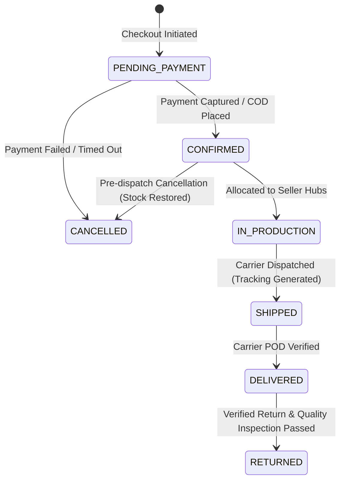

# NEXU ATELIER — Core Commerce Engine & Shopping Lifecycle

## 1. Product Discovery & Catalog Engine

- **Catalog Architecture:** Products are organized into verified artisan categories (`Category`), each defining required and optional dynamic attributes (`CategoryAttribute`).
- **Variant Modeling:** Products support multidimensional variants (`ProductVariant`) with unique SKUs, stock levels, and price offsets (`additionalPricePaise`).
- **Stock Indicators:**
  - `stock > lowStockThreshold`: Normal availability badge.
  - `0 < stock <= lowStockThreshold`: Urgent low stock indicator ("Only X pieces remain in atelier").
  - `stock === 0`: Out of stock badge with disabled purchasing and back-in-stock notification option.

---

## 2. Cart & Instant Buy Now Engine

### 2.1 Cart Arithmetic & Client-Server Synchronization
- **Client Cart (`CartContext`):** Optimistic local updates for instantaneous UI feedback.
- **Server Authority:** On checkout or drawer sync, cart items are re-validated against active database stock and prices.
- **Ensemble Bundling (`FrequentlyBoughtTogether`):**
  - Allows customers to purchase curated multi-piece ensembles with a single click.
  - Automatic bundle discount applied dynamically (e.g., 3% for 2 items, 5% for 3 items).

### 2.2 Instant "Buy Now" Journey
- "Buy Now" constructs a direct single-item checkout session bypassing persistent cart contents.
- Redirects immediately to `/checkout?direct=1&sku=...` while maintaining full coupon and address eligibility checks.

---

## 3. Promotions & Coupon Rules Engine

Coupons are managed via the `Coupon` table and enforced in `order-service.ts`:
1. **Validation Checks:**
   - Active status: `coupon.isActive === true`.
   - Date range: `startsAt <= now <= (expiresAt || infinity)`.
   - Minimum order value: `subtotalPaise >= coupon.minOrderValuePaise`.
   - Usage limits: `timesUsed < usageLimit` and `customerUsages < perCustomerLimit`.
2. **First-Order Only Rule (`NEXUFIRST`):**
   - Enforces `prisma.order.count({ where: { customerId, status: { notIn: ["CANCELLED"] } } }) === 0`.
   - Caps discount at `maxDiscountPaise` (e.g., ₹2,500 maximum discount).
3. **Free Shipping Promotion (`FREESHIP`):**
   - Calculates standard shipping charge as ₹0 while keeping subtotal and taxes exact.

---

## 4. Payment States & Order Lifecycle

- **Idempotency Guard:** Every checkout submission must provide a unique `idempotencyKey` to prevent double-charging or duplicate order creation during network retries.
- **Pre-dispatch Cancellation:** Orders in `CONFIRMED` or `IN_PRODUCTION` can be cancelled by the customer, triggering automated inventory restoration and full refund queueing.
