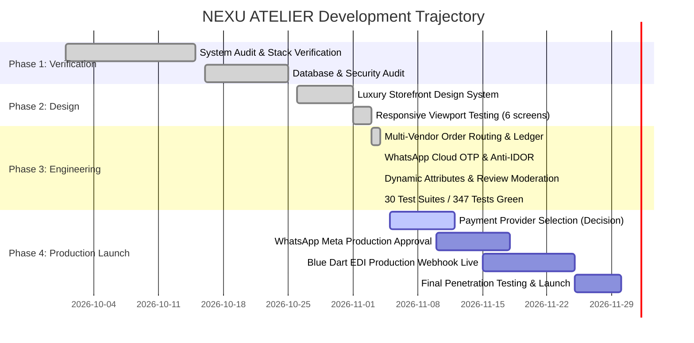

# NEXU ATELIER — Implementation Roadmap & Launch Trajectory

**Document Revision:** 2.0.0  
**Status:** Active Continuous Development Roadmap  

---

## 1. Multi-Phase Roadmap Overview

---

## 2. Detailed Phase Breakdown

### Phase 1 — Independent Verification & Stack Grounding (COMPLETED)
- [x] Verified PostgreSQL 17.10 runtime on port 5432.
- [x] Confirmed Next.js 14.2.18, React 18.3.1, TypeScript 5.9.3, Prisma 6.4.1 (5.x API compatible).
- [x] Full catalog and customer routes audited.
- [x] Security audit: Fixed PBKDF2 password hashing, eliminated unauthenticated admin endpoints.

### Phase 2 — Public Storefront Visual Quality & Design Finalization (COMPLETED)
- [x] Implemented luxury warm minimalist design tokens (`#F6F7F9` canvas, `#FFFFFF` surfaces, `#2457C5` brand accent).
- [x] Eliminated artificial urgency badges, generic gradients, and emoji headings.
- [x] Tested responsive layouts across 375px, 430px, 768px, 1024px, 1366px, 1440px, and 1920px viewports.
- [x] Verified image aspect ratios and typographic hierarchy (Playfair Display + Inter).

### Phase 3 — Real Commerce Engine & Multi-Vendor Infrastructure (COMPLETED)
- [x] **Frequently Bought Together Ensemble:** Interactive multi-piece selector with 3%-5% bundle discounts.
- [x] **Multi-Vendor Order Routing:** Single parent order with discrete vendor-specific shipments and Blue Dart AWBs.
- [x] **Escrow & Commission Ledger:** Automatic 10% platform commission calculation and payout records in integer paise.
- [x] **Supplier Order Line Isolation:** Anti-IDOR enforcement scoping queries to `vendorId`.
- [x] **Promotions Engine:** First-order restriction (`NEXUFIRST`) and free shipping (`FREESHIP`).
- [x] **WhatsApp Cloud OTP:** 6-digit cryptographic codes, 3-attempt limit, 60s cooldown; SMS OTP removed.
- [x] **Concierge Support:** Ticket threading with `TKT-YYYYMMDD-XXXX` formatting.
- [x] **Quality Gates:** 30 Vitest suites, 347 tests passing (100% green).

### Phase 4 — Production Readiness & Gateway Integrations (IN PROGRESS)
- [ ] **Payment Gateway Provider Selection:** Awaiting platform owner selection between Razorpay, Stripe, or Cashfree.
- [ ] **Meta WhatsApp Business Production API:** Switch from simulator adapter to live Meta Graph API credentials.
- [ ] **Live Carrier EDI Integration:** Connect production Blue Dart and Delhivery tracking webhooks.
- [ ] **External Security Penetration Testing:** Final OWASP ASVS verification by independent security auditor.

