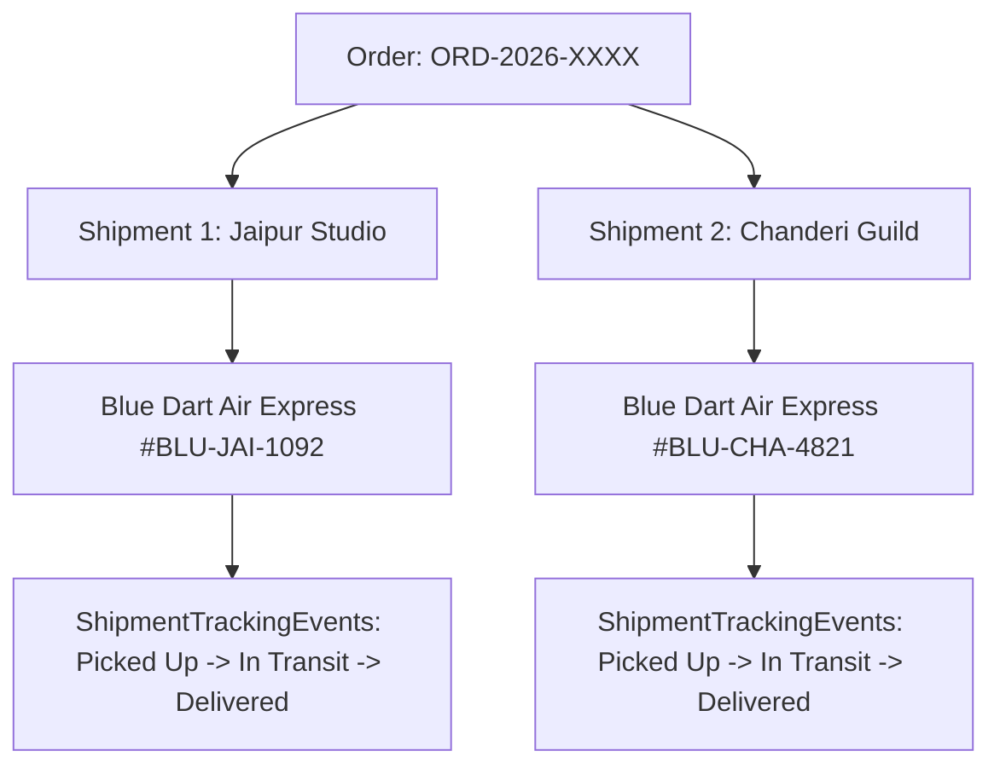

# NEXU ATELIER — Inventory Management & Logistics Fulfillment

**Document Revision:** 2.0.0  
**Status:** Authoritative Inventory & Logistics Specification  

---

## 1. Inventory Architecture & SKU Modeling

1. **Product & Variant Hierarchy:**
   - A base product (`Product`) holds general atelier attributes and category linkage.
   - Individual purchaseable units are defined by `ProductVariant`, each bearing a unique `sku` (e.g., `SLK-CHA-001-GOLD`).
2. **Stock Counters:**
   - `stock (Int)`: Current available inventory in the maker's workshop.
   - `lowStockThreshold (Int)`: Default is 5 units. Triggers urgency indicators in the storefront.
3. **Pessimistic Atomic Decrement:**
   - Prevents race conditions during flash sales or high-concurrency traffic:
     ```ts
     const updated = await tx.productVariant.updateMany({
       where: { id: variantId, stock: { gte: requestedQuantity } },
       data: { stock: { decrement: requestedQuantity } },
     });
     if (updated.count === 0) throw new Error("OUT_OF_STOCK");
     ```

---

## 2. Stock Restoration Lifecycle

When an order or specific line item is cancelled prior to shipment:
1. **Interactive Transaction:** Stock restoration must occur inside `prisma.$transaction`.
2. **Atomic Increment:**
   ```ts
   await tx.productVariant.updateMany({
     where: { sku: item.selectedSku },
     data: { stock: { increment: item.quantity } },
   });
   ```
3. **Audit Trail:** An `AuditEvent` is generated linking the cancellation reason to the inventory release.

---

## 3. Multi-Vendor Fulfillment & Logistics Architecture

Because vendors operate from different origin hubs across India (e.g., Chanderi, Jaipur, Moradabad), each order is divided into vendor-specific consignments (`Shipment`):



### 3.1 Carrier Integration & Tracking
- **Carrier Partners:** Primary domestic air express is Blue Dart Air Express; surface cargo uses Delhivery.
- **Tracking Identifiers:** Stored uniquely in `Shipment.trackingNumber`.
- **Consignment Milestones (`ShipmentStatus`):**
  1. `PENDING_FULFILLMENT`: Item allocated to supplier.
  2. `LABEL_CREATED`: Shipping label and manifest printed.
  3. `PICKUP_SCHEDULED`: Courier pickup booked.
  4. `SHIPPED`: Courier scanned package at origin hub.
  5. `IN_TRANSIT`: Sorting through transit hub.
  6. `OUT_FOR_DELIVERY`: On delivery vehicle.
  7. `DELIVERED`: Proof of Delivery (POD) confirmed.

---

## 4. Return Logistics & Reverse Pickup

- **Customer Window:** 7 days post-delivery.
- **Reverse Consignment:** Upon admin approval of `ReturnRequest`, reverse AWB is generated.
- **Intake Inspection:** Warehouse or artisan inspects returned piece for original tags, undamaged luxury box, and unworn condition before triggering refund.
