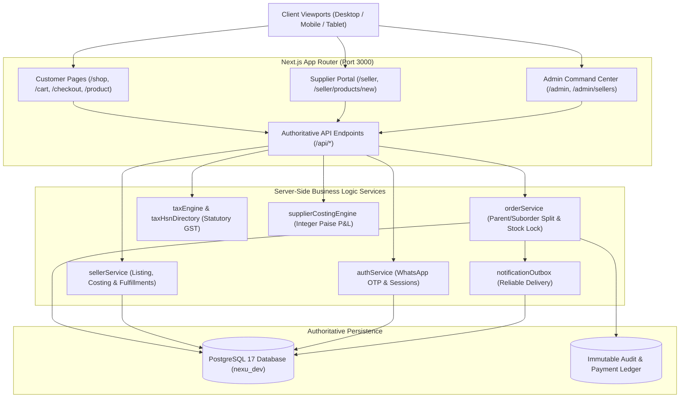

# NEXU ATELIER — Master Marketplace Architecture & System Topology

## 1. High-Level Architectural Topology

NEXU ATELIER is engineered as an enterprise-grade multi-tenant e-commerce marketplace powered by Next.js 14 App Router, PostgreSQL 17, and Prisma ORM.

---

## 2. Multi-Vendor Suborder Splitting Topology

When a customer checks out a shopping bag containing items from multiple distinct artisan studios:
1. **Parent Order Creation:** One master order record (`Order`) is created capturing total customer bill, billing address, and payment capture.
2. **Suborder Allocation:** The order engine groups `OrderItem` records by `supplierId` / `vendorId`.
3. **Tenant Enclosure:**
   - **Seller 1** inspects `/seller/orders` and accesses **strictly Suborder 1** (items, packaging slip, and net settlement for Seller 1).
   - **Seller 2** inspects `/seller/orders` and accesses **strictly Suborder 2**.
   - **Customer** inspects `/account/orders` and views a unified parent order with separate fulfillment tracks for each studio consignment.
   - **Super Admin** inspects `/admin/orders` with macro governance over parent orders, suborders, escrow holds, and platform take rates.

---

## 3. Data Integrity & Concurrency Architecture

- **ACID Transactions:** Inventory decrements, order creations, and outbox event logging execute atomically within `prisma.$transaction`.
- **Zero Client Trust:** All prices, discounts, tax rates, and commission percentages are computed server-side using authoritative database models. Client tampering is discarded.
- **Tenant Scoped Queries:** Logical tenant isolation is enforced by middleware filtering queries by `vendorId === session.seller.id`. Cross-tenant mutations return HTTP 403 Forbidden.
