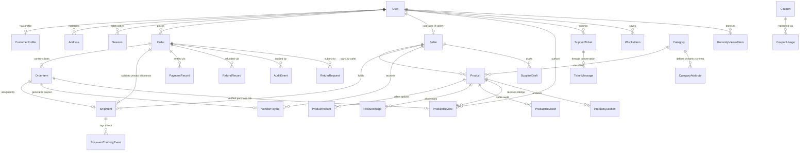

# NEXU ATELIER — Marketplace Domain Model & Entity Relationships

**Document Revision:** 1.0.0  
**Status:** Authoritative Domain Specification  

---

## 1. Domain Entity Relationship Diagram

---

## 2. Core Entities & Field Specifications

### 2.1 Identity & Access
- **`User`:** Root actor. Fields: `id (cuid)`, `email (unique)`, `passwordHash (PBKDF2)`, `role (CUSTOMER | SELLER | ADMIN)`, `isSuspended`.
- **`CustomerProfile`:** Customer preferences, WhatsApp consent, marketing consent, phone verification state, and COD refusal counters.
- **`Session`:** Ephemeral session token (`cuid`) with `expiresAt` and user reference.
- **`Address`:** Delivery destination with `street`, `city`, `state`, `pincode (6-digit)`, `phone`, and `isDefault`.

### 2.2 Product & Catalog Hierarchy
- **`Category`:** Luxury product vertical (e.g., Silk & Handlooms, Brass & Stoneware, Heritage Furniture).
- **`CategoryAttribute`:** Dynamic dynamic attribute definitions (e.g., Weave Technique, Material Composition, Thread Count).
- **`Product`:** Authoritative product catalog row. Fields: `slug`, `title`, `basePricePaise`, `stock`, `approvalStatus`, `vendorId`, `rating`.
- **`ProductVariant`:** SKU-specific row with `variantType`, `value`, `stock`, and `additionalPricePaise`.
- **`ProductImage`:** Gallery media with `url`, `alt`, and `sortOrder`.

### 2.3 Commerce & Multi-Vendor Ordering
- **`Order`:** Parent customer order. Fields: `id (ORD-YYYY-UUID)`, `customerId`, `subtotalPaise`, `shippingFeePaise`, `discountPaise`, `totalPaise`, `status`, `paymentStatus`.
- **`OrderItem`:** Line item with snapshot fields (`title`, `productSlug`, `vendorId`, `vendorName`, `unitPricePaise`, `quantity`, `lineTotalPaise`, `fulfillmentStatus`).
- **`Shipment`:** Vendor-isolated delivery container with `trackingNumber`, `carrierName`, and `status`.
- **`VendorPayout`:** Ledger record calculating `grossAmountPaise`, `commissionPaise` (10%), and `netPayoutPaise` in `ESCROW_HOLD`.
- **`PaymentRecord`:** Gateway transaction log with `transactionRef`, `provider`, `amountPaise`, and `status`.
- **`RefundRecord`:** Reversible credit record with `idempotencyKey` and `amountPaise`.

### 2.4 Customer Engagement & Support
- **`ProductReview`:** Rating (1-5), verified purchase check, review title, and comments with `ReviewMedia` attachments.
- **`ProductQuestion` & `ProductAnswer`:** Community and artisan Q&A engine.
- **`SupportTicket` & `TicketMessage`:** Patron concierge tickets with unique tracking number (`TKT-YYYYMMDD-XXXX`), category enum, and priority SLA.
- **`ReturnRequest`:** 7-day return and replacement management.
- **`WishlistItem` & `RecentlyViewedItem`:** Real-time customer curation and browsing memory.

