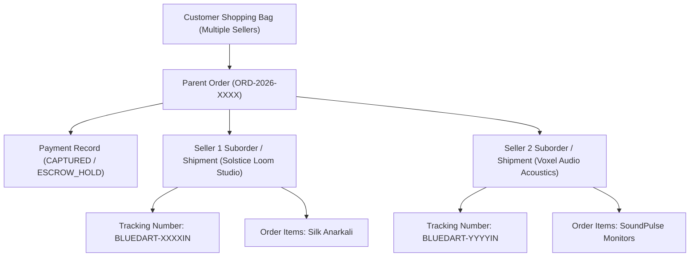

# NEXU ATELIER — MULTI-VENDOR ORDER FLOW & SETTLEMENT ARCHITECTURE

**Platform Ownership:** Platform Operator (NEXU ATELIER)  
**Database:** PostgreSQL 17 (`Order`, `OrderItem`, `Shipment`, `PaymentRecord`, `AuditEvent`)  
**Currency Standard:** Server-authoritative integer paise (1 INR = 100 paise)  
**Date:** 2026-11-04  

---

## 1. Multi-Vendor Order Decomposition

When a customer checks out a cart containing items from multiple independent artisan studios or sellers:

### Key Architectural Tenets:
1. **Single Customer Transaction:** The patron makes a single unified payment for the parent order.
2. **Seller Isolation:** Each seller receives a dedicated `Shipment` record with an independent tracking number (`BLUEDART-XXXXIN`) and seller-specific fulfillment status (`LABEL_CREATED`, `PICKED_UP`, `IN_TRANSIT`, `DELIVERED`).
3. **Partial Cancellation & Returns:** A cancellation or return for Seller 1's piece does not cancel or invalidate Seller 2's shipment.
4. **Escrow Protection:** Payment remains held in escrow until the carrier confirms parcel delivery, after which vendor payout ledgers are unlocked.

