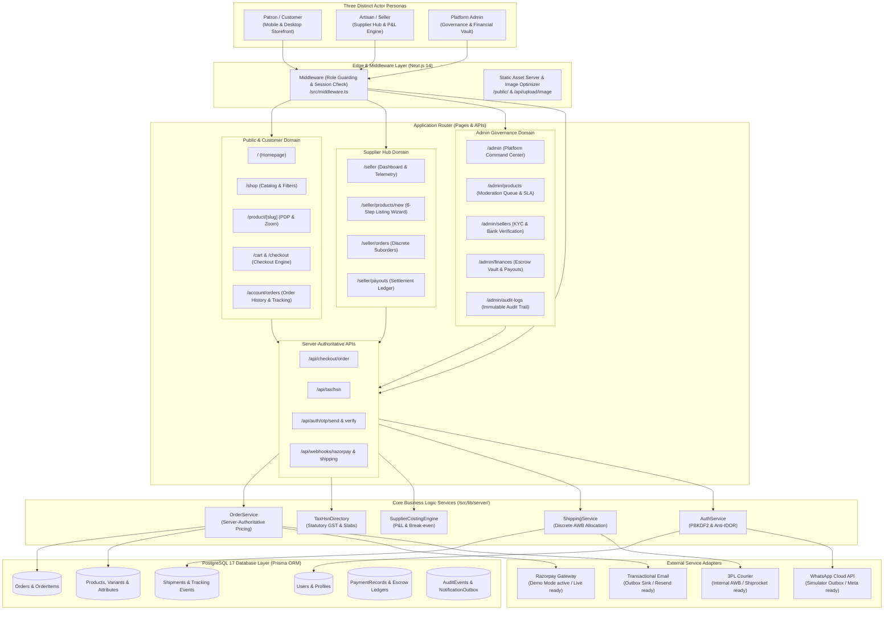

# NEXU ATELIER — ARCHITECTURE MAP & SYSTEM TOPOLOGY
**Platform:** NEXU ATELIER Luxury Multi-Vendor Marketplace  
**Engine:** Next.js 14 App Router + PostgreSQL 17 + Prisma ORM  
**Date:** November 5, 2026  

---

## 1. HIGH-LEVEL SYSTEM TOPOLOGY



---

## 2. MULTI-VENDOR SUBORDER SPLITTING TOPOLOGY

```text
[CUSTOMER CHECKOUT: 1 Cart with 3 Items from 2 Sellers]
                           │
                           ▼
                  [PARENT ORDER CREATION]
               Order ID: ORD-2026-X8F92A
               Total: ₹8,450 (In Escrow Hold)
                           │
             ┌─────────────┴─────────────┐
             ▼                           ▼
    [SELLER 1 SUBORDER]         [SELLER 2 SUBORDER]
   Seller: Jaipur Silks        Seller: Kashmir Crafts
   Items: Silk Sari (₹5,200)   Items: Pashmina Shawl (₹3,250)
   Shipment: SHP-2026-A101     Shipment: SHP-2026-B202
   Carrier: Bluedart Air       Carrier: Delhivery Express
   AWB: BD-AIR-173000-01       AWB: DEL-EXP-173000-02
             │                           │
             ▼                           ▼
   [DELIVERY CONFIRMED]        [DELIVERY CONFIRMED]
   Escrow Released: ₹4,836     Escrow Released: ₹3,022
   (after 7% Commission)       (after 7% Commission)
```
