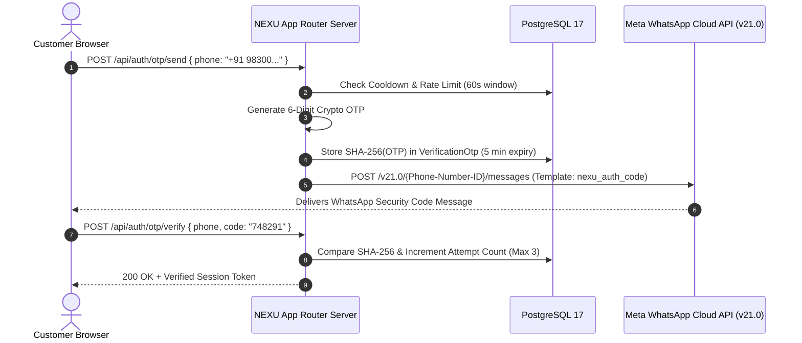

# NEXU ATELIER — Notification Architecture & Communications Protocol

**Document Revision:** 2.0.0  
**Status:** Authoritative Communication Engineering Specification  

---

## 1. Core Channel Strategy & Policies

NEXU ATELIER maintains a strict two-channel communications strategy:
1. **WhatsApp Cloud API (v21.0):** The primary real-time channel for OTP security verification, rapid order receipts, dispatch alerts, and out-for-delivery notifications.
2. **Transactional Email:** The official documentary channel for luxury tax invoices, patron onboarding, seller fulfillment manifests, and platform escalations.
3. **SMS OTP Ban:** SMS OTP is completely deprecated and removed to prevent SIM-swap hijacking, toll-fraud pumping, and Indian telecom DLT delivery delays.

---

## 2. WhatsApp Business Cloud API Integration

### 2.1 Approved Template Specifications

| Template Name | Category | Language | Parameters | Intended Trigger |
| :--- | :--- | :--- | :--- | :--- |
| `nexu_auth_code` | `AUTHENTICATION` | `en_US` | `{{1}}` (6-digit OTP) | Login, registration, password reset |
| `nexu_order_confirmed` | `UTILITY` | `en_US` | `{{1}}` (Name), `{{2}}` (Order ID), `{{3}}` (Total INR) | Successful checkout |
| `nexu_shipment_dispatched` | `UTILITY` | `en_US` | `{{1}}` (Order ID), `{{2}}` (Carrier), `{{3}}` (AWB) | Carrier pickup scan |
| `nexu_out_for_delivery` | `UTILITY` | `en_US` | `{{1}}` (Order ID), `{{2}}` (Delivery Date) | Morning delivery run |

---

## 3. Transactional Email Engine

### 3.1 Architecture & Idempotency
- All emails pass through `sendTransactionalEmail()` in `src/lib/server/notification-service.ts`.
- Every dispatch event logs to `NotificationEvent` with `idempotencyKey` preventing duplicate emails.
- If delivery fails due to network timeout, status is set to `QUEUED` with automated exponential backoff retries (1 min, 5 min, 15 min).

### 3.2 HTML Email Templates
- **`WELCOME_PATRON`:** Onboarding letter from the Atelier Director with bespoke discovery recommendations.
- **`ORDER_CONFIRMED`:** Comprehensive tax receipt including high-resolution item thumbnails, breakdown of GST and shipping, and maker origins.
- **`SUPPLIER_NEW_ORDER`:** Supplier order allocation manifest detailing packaging standards and Blue Dart pickup window.
- **`ORDER_CANCELLED`:** Cancellation receipt confirming inventory release and automated refund timeline.
- **`ADMIN_SLA_ESCALATION`:** Automated alert triggered when supplier product drafts exceed the 60-minute review SLA.
