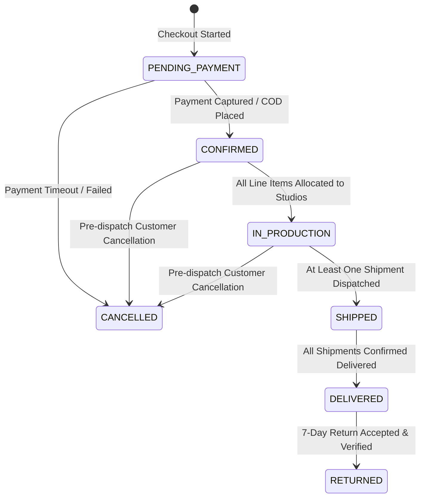

# NEXU ATELIER — Order Lifecycle & Multi-Vendor State Machine

**Document Revision:** 2.0.0  
**Status:** Authoritative State Transition Architecture  

---

## 1. Parent Order State Machine

---

## 2. Fulfillment Statuses & Seller Transitions

Each individual `OrderItem` tracks an independent fulfillment status managed by its respective vendor:

| Status | Permitted Transitions | Who Triggers | Description |
| :--- | :--- | :--- | :--- |
| **`NEW`** | `PROCESSING`, `CANCELLED` | System / Supplier | Item newly allocated to artisan workshop |
| **`PROCESSING`** | `PACKED`, `CANCELLED` | Supplier | Artisan preparing craft, inspecting materials |
| **`PACKED`** | `SHIPPED` | Supplier | Goods packed in atelier box with authenticity card |
| **`SHIPPED`** | `DELIVERED` | 3PL Carrier Webhook | Consignment handed to Blue Dart Air Express |
| **`DELIVERED`** | `RETURNED` | Customer + Admin | Delivered to patron; return window opens (7 days) |
| **`RETURNED`** | None | Admin | Returned to atelier; refund issued |
| **`CANCELLED`** | None | Customer / Admin | Cancelled prior to dispatch; stock restored |

---

## 3. Parent Status Aggregation Algorithm

Because a parent order may contain items from multiple suppliers, the overall `Order.status` is calculated from child `OrderItem.fulfillmentStatus`:

1. If **all** items are `CANCELLED` $\rightarrow$ Order status is `CANCELLED`.
2. If **all** items are `RETURNED` $\rightarrow$ Order status is `RETURNED`.
3. If **all** items are `DELIVERED` $\rightarrow$ Order status is `DELIVERED`.
4. If **any** item is `SHIPPED` or `DELIVERED` $\rightarrow$ Order status is `SHIPPED`.
5. If **any** item is `PROCESSING` or `PACKED` $\rightarrow$ Order status is `IN_PRODUCTION`.
6. Otherwise $\rightarrow$ Order status remains `CONFIRMED`.

---

## 4. Partial Cancellations & Partial Returns

### 4.1 Partial Pre-Dispatch Cancellation
- If a patron wishes to cancel a single item before dispatch:
  1. The specific `OrderItem` status transitions to `CANCELLED`.
  2. The variant's reserved stock is restored: `update({ where: { sku }, data: { stock: { increment: quantity } } })`.
  3. The associated `VendorPayout` is set to `WITHHELD`.
  4. A partial refund record (`RefundRecord`) is queued for the item line amount minus proportional coupon discount.
  5. The parent order totals are updated, and remaining items proceed normally.

### 4.2 Partial Post-Delivery Return
- Returns must be requested within 7 calendar days of delivery via `ReturnRequest`:
  1. Patron provides reason, explanation, and condition photos.
  2. Platform Admin reviews and approves reverse pickup.
  3. Reverse courier retrieves consignment.
  4. Upon warehouse inspection, `OrderItem.fulfillmentStatus` becomes `RETURNED`.
  5. Refund is released to original payment method or UPI.
