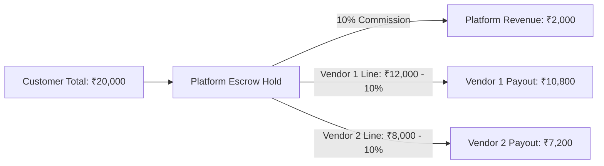

# NEXU ATELIER — Payment Architecture & Financial Ledger

**Document Revision:** 2.0.0  
**Status:** Authoritative Financial Engineering Specification  

---

## 1. Zero-Cardholder-Data & PCI Compliance Policy

- **Strict Zero-Storage Invariant:** NEXU ATELIER never accepts, logs, transmits, or stores Primary Account Numbers (PAN), CVVs, or cardholder security codes.
- **Client-Side Tokenization:** All credit/debit card transactions leverage secure payment gateways (e.g., Razorpay / Stripe Elements), passing only opaque gateway tokens (`gatewayToken`) to backend services.
- **Masked Metadata Only:** Stored card profiles in `SavedPaymentMethodToken` contain only non-sensitive tokens, `cardBrand`, and `last4` for customer identification.

---

## 2. Integer Paise Precision & Currency Law

All financial calculations and database columns are strictly integers representing Indian Paise (1 INR = 100 Paise):
$$\text{Base Unit} = 1\text{ Paisa} = ₹0.01$$

```ts
// Canonical conversion helper
export function paiseToRupees(paise: number): number {
  return paise / 100;
}

export function rupeesToPaise(rupees: number): number {
  return Math.round(rupees * 100);
}
```

---

## 3. Double-Entry Escrow Ledger & Vendor Payouts

When an order is placed, customer funds enter the platform escrow account. Funds are split across vendors and platform commission:



### 3.1 Payout Lifecycle (`VendorPayout`)
1. **`ESCROW_HOLD`:** Default state on order placement. Funds are locked.
2. **`ELIGIBLE_FOR_PAYOUT`:** Automatically updated 7 days post-delivery if no return or dispute is open.
3. **`PROCESSING`:** Settlement batch initiated with bank/payment rails.
4. **`SETTLED`:** Funds transferred to vendor's verified bank account (`bankAccountNumber`, `bankIfsc`).
5. **`WITHHELD`:** In the event of order cancellation, customer return, or supplier dispute.

---

## 4. Payment Gateway Webhook Verification

Every webhook notification (Razorpay, Stripe, or 3PL logistics) must be cryptographically validated prior to ingestion:

```ts
export function verifyWebhookSignature(
  rawBody: Buffer,
  signature: string,
  secret: string
): boolean {
  const expectedSignature = crypto
    .createHmac("sha256", secret)
    .update(rawBody)
    .digest("hex");
  return crypto.timingSafeEqual(Buffer.from(signature), Buffer.from(expectedSignature));
}
```

- **Idempotency Safeguard:** Webhooks are recorded in `WebhookEvent` with `@@unique([provider, eventId])`. Duplicate deliveries are flagged as `IGNORED` without re-executing state changes.

---

## 5. Daily & Monthly Financial Reconciliation

- The reconciliation engine compares captured gateway transactions (`PaymentRecord`) against internal order totals (`Order.totalPaise`).
- Logs discrepancies to `FinancialReconciliation`. If $\text{totalDiscrepancyPaise} \neq 0$, the system generates an immediate escalation event to platform finance administrators.

