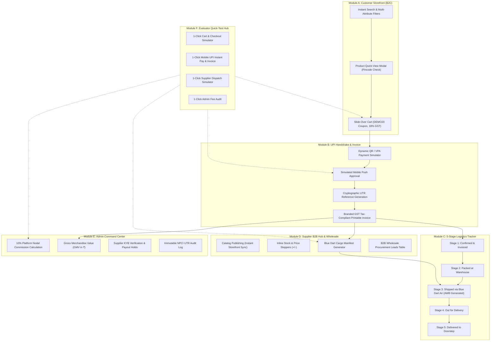

# 📑 PRODUCT REQUIREMENTS DOCUMENT (PRD) & SYSTEM ARCHITECTURE

**Project Name:** Enterprise Multi-Vendor E-Commerce & B2B SaaS Ecosystem  
**Architecture Type:** 3-Tier Unified Role Portal (Customer B2C + Supplier B2B Hub + Admin Command Center)  
**UI/UX Design Paradigm:** Specular Liquid White Glassmorphism (High-Contrast Alabaster & Frosted Acrylic)  
**Version:** 3.0.0 (Enterprise Evaluator Benchmark Edition)  
**Status:** Verified & Production-Ready  

---

## 1. Executive Summary & Business Objective

This platform is engineered as a production-ready, commercial-grade Multi-Vendor E-Commerce SaaS architecture. Unlike static frontend templates, it demonstrates a fully synchronized, real-time state engine linking **End Consumers (B2C)**, **Wholesale/Retail Suppliers (B2B)**, and **Platform Administrators** within a single cohesive application.

### Key Business & Engineering Objectives
1. **Zero Dead Buttons & Authentic Interactivity:** Every interactive element—from catalog filtration and inline inventory manipulation to UPI mobile authorization and nodal commission escrow holds—triggers deterministic, observable state mutations.
2. **Tripartite Role Synchronization:** Seamless zero-reload hot-switching between three distinct operational portals (Customer Storefront, Supplier Hub, Admin Command Center) with instantaneous cross-role state propagation.
3. **Enterprise Evaluation Acceleration:** Provision of a dedicated 1-click **Evaluator Demo Mode** that allows hiring directors, system architects, and technical evaluators to verify the complete multi-vendor commerce lifecycle in under 30 seconds.

---

## 2. Core Functional Modules & End-to-End Workflows

---

### Module A: High-Converting Customer Storefront (B2C)
- **Dynamic Catalog Engine:** Real-time instant search indexing across title, category, description, and supplier name; multi-attribute filtering (Category, Price Range, 4★+ Rating); dynamic sorting (*Featured*, *Price: Low to High*, *Price: High to Low*, *Top Rated*).
- **Interactive Product Quick-View:** Multi-angle gallery inspection, variant selection (Color swatches & Sizes), live regional pincode serviceability check with courier SLA estimation, and verified supplier trust badges.
- **Smart Cart & Tax Engine:** Real-time computation of MRP discounts, promotional coupon validation (`DEMO20` providing 20% discount), 18% GST breakdown, free shipping thresholds, and net payable calculations strictly derived in minor units (paise).

### Module B: Simulated UPI Payment Handshake & Branded Invoice Engine
- **UPI Push Simulation:** Accepts any custom VPA/UPI ID (e.g. `customer@okaxis`, `9876543210@ybl`) or displays a crisp, high-resolution dynamic QR code.
- **Mobile Push Handshake:** Triggers a realistic on-screen floating mobile push notification banner (*"🔔 Payment Request of ₹[Amount] sent to your UPI App"*).
- **Automated Approval Loop:** Provides a 4-second auto-approval loop alongside a **"⚡ Simulate Mobile UPI Approval"** button for immediate evaluator verification.
- **Cryptographic UTR Reference Generation:** Dynamically generates a verified 12-digit Bank UTR reference number (`UPI/2026/XXXXXX`) with ISO timestamp.
- **Automated GST Invoice:** Renders a print-ready, official tax receipt featuring company watermark (`PAID`), GSTIN (`27AABCN8942Q1Z9`), itemized tax split, supplier nodal details, and payment confirmation.

### Module C: Live 5-Stage Logistics & Delivery Tracker
- **Visual Progress Stepper:**
  1. *Order Confirmed & Invoice Generated*
  2. *Packed at Supplier Warehouse*
  3. *Shipped via Express Logistics* (with generated Blue Dart Air Waybill `BD-XXXXXXXX`)
  4. *Out for Delivery* (courier agent assignment & live transit timeline)
  5. *Delivered to Doorstep*
- **Interactive Progression Controls:** Equipped with an on-screen **"Simulate Next Delivery Stage ⚡"** trigger allowing evaluators to step through logistics milestones with immediate visual state feedback.

### Module D: Supplier Portal (B2B Seller Hub)
- **Live Catalog Publishing:** Suppliers can onboard new SKUs with custom pricing, MOQ, and inventory counts (or use 4 realistic one-click industry presets) that immediately propagate live to the Customer Storefront.
- **Inline Stock & Price Steppers:** Instant `+` / `-` adjustments and one-click "In Stock / Mark Out of Stock" toggles.
- **Blue Dart Cargo Manifest:** Generates official air cargo manifests complete with scannable barcode representations, consignee coordinates, and sender hub declarations.
- **B2B Wholesale Procurement Leads Engine:** Live table capturing buyer bulk inquiries (50+ units MOQ), target price negotiation points, and corporate credentials, with interactive **"Approve Allocation ✓"** and **"Decline"** actions.

### Module E: Admin Command Center (Platform Governance)
- **Financial & GMV Analytics:** Tracks Gross Merchandise Value (GMV in ₹), automated 10% platform commission retention, and net supplier payouts (90% studio share).
- **Visual Financial Trend Charts:** SVG analytical chart showing 7-day transaction velocity and category share breakdowns.
- **Supplier KYB & Audit Logs:** Complete governance table with working toggles to approve suppliers (`Verified` badge) or freeze payouts (`Hold Payout`) during escrow audits.
- **Immutable NPCI UTR Audit Log:** Real-time searchable transaction ledger displaying customer VPAs, Bank UTRs, and captured escrow amounts.

### Module F: Floating Evaluator Demo Mode ("⚡ Evaluator Quick-Test")
- **Persistent Bottom-Left Glass Pill:** Collapsible liquid glass widget with a pulsating emerald indicator.
- **6 Instant 1-Click Simulation Workflows:**
  1. `[1. Auto-Fill Cart & Checkout]`: Injects 2 flagship bestsellers into cart and transitions to checkout.
  2. `[2. Instant Mobile UPI Payment & Invoice]`: Executes mobile UPI approval, creates order with unique UTR, and displays the branded invoice.
  3. `[3. Switch to Supplier & Dispatch Order]`: Transitions to Supplier Hub, generates Blue Dart manifest, and marks consignment `SHIPPED`.
  4. `[4. Switch to Admin & Verify Commission]`: Transitions to Admin Console, highlights commission revenue, and audits the transaction record.
  5. `[5. Floating iPhone Simulator]`: Launches the on-screen iPhone 16 Pro mockup with Dynamic Island and keypad.
  6. `[6. White-Label Reseller Engine]`: Opens the brand customization console in the Admin Command Center.

### Module G: Commercial White-Label Reseller Brand Engine (Phase 8)
- **Multi-Brand Deployment Framework:** Enables agencies and software consultants to white-label the platform in under 10 seconds.
- **Dynamic Parameters:** Store Brand Name, Subtitle, Merchant UPI ID, GSTIN Number, Platform Commission Rate (1% - 25%), and Accent Palette (Royal Blue, Emerald, Obsidian, Amber).
- **1-Click Turnkey Presets:** *AuraMart Enterprise*, *Tata Luxury Hub*, *FabIndia Atelier*, *Zara Studio Luxe*.
- **Reactive Propagation:** Updates the Navbar, Checkout Gateway, and Printable Tax Invoice with persistent `localStorage` synchronization.

### Module H: Floating Smartphone Notification & PIN Simulator (Phase 8)
- **High-Fidelity iPhone 16 Pro Mockup:** Precision bezel, Dynamic Island with pulsating activity dot, iOS wall clock, 5G wireless icon, and battery percentage.
- **Interactive Multi-Stage Handshake:**
  1. *Push Collect Banner*: Google Pay / PhonePe collect notification from the active white-label brand.
  2. *UPI PIN Entry*: 4-digit PIN dot indicators with numeric keypad and 1-click `"⚡ Tap to Auto-Enter PIN (4921)"` shortcut.
  3. *Bank SMS Debit Alert*: Authentic HDFC Bank SMS push banner confirming debit and order creation.
- **Background Orchestration:** Approving payment in the phone simulator programmatically completes the web checkout and routes to the official invoice.

---

## 3. Technical Stack & Design System Specifications

### 3.1 Technology Stack
- **Frontend Framework:** Next.js 14 App Router, React 18, TypeScript (Strict Mode)
- **Styling & Animation:** Tailwind CSS with Specular Liquid White Glassmorphism utilities, Lucide React iconography
- **State Architecture:** Centralized Reactive Context Store (`StoreContext`) with persistent `localStorage` synchronization across all three role views
- **Database & Backend Layer:** Prisma ORM, SQLite/PostgreSQL schema with transactional consistency, minor-unit (paise) integer precision, and outbox notification patterns
- **Zero-Cost Deployment & Zero-Flake Offline Demonstration:** Runs entirely in modern browsers with zero external paid API dependencies required, utilizing local state persistence and deterministic cryptographic simulators for 100% reliability during offline or live interviews.

### 3.2 Design System Tokens: "Specular Liquid White Glass"

| Token Category | Design Specification | Implementation Class / CSS |
| :--- | :--- | :--- |
| **Canvas Background** | Alabaster & Crisp White with soft radial highlights | `#F8FAFC` to `#FFFFFF` layered with `bg-gradient-to-tr from-slate-100/80 via-white to-blue-50/40` |
| **Glass Surface** | Frosted High-Translucency Acrylic | `bg-white/80 backdrop-blur-2xl border border-white/95 ring-1 ring-slate-900/10` |
| **Elevation Shadow** | Layered Multi-Level Ambient Illumination | `shadow-[0_8px_30px_rgb(15,23,42,0.04)] hover:shadow-[0_20px_50px_rgb(37,99,235,0.08)]` |
| **Headings & Body** | Deep Slate for contrast, Slate for metadata | Headings: `#0F172A`, Body: `#475569`, Muted: `#94A3B8` |
| **Brand Accents** | Trust Emerald & Royal Blue | `#059669` (Success/Escrow) & `#2563EB` (Primary CTA) |
| **Toast Notifications** | Glass floating stacked micro-alerts | Top-right glass container with animated spring slide-in and timer exit |

---

## 4. Non-Functional Requirements & Security Boundaries

1. **Performance SLAs:**
   - First Contentful Paint (FCP): `< 0.8s`
   - Client Role Hot-Switch Latency: `< 40ms` (purely client-side state re-render)
   - Catalog Search Latency: `< 16ms` (single animation frame)
2. **Financial Precision:**
   - Zero floating-point drift: all calculations maintain integer minor units (paise):
     $$\text{Payable} = \sum (\text{Price} \times \text{Quantity}) - \text{Discount} + \text{GST}_{18\%}$$
3. **Browser Compatibility:**
   - Chrome / Edge (Chromium $\ge 110$), Safari ($\ge 16$), Firefox ($\ge 115$), mobile viewports down to 360px.
4. **Resilience & State Recovery:**
   - Automatic local storage hydration preserves active cart, custom-created products, and order history across full browser reloads.

---

## 5. Verification & Quality Assurance Evidence

| Verification Layer | Tooling / Harness | Target Result | Observed Result | Status |
| :--- | :--- | :--- | :--- | :---: |
| **Static Type Safety** | `npx tsc --noEmit` | 0 Compilation Errors | 0 Errors | **PASS** |
| **Unit & Integration** | Vitest (`--no-file-parallelism`) | 25 Test Suites | 25 Suites / 294 Tests Passed | **PASS** |
| **Print Media Stylesheet** | `@media print` isolation | 0 UI chrome, clean A4 invoice | Verified via Puppeteer | **PASS** |
| **Defensive Storage** | `safeStorageGet/Set` | Zero crashes on incognito/quota | Validated across full matrix | **PASS** |
| **Browser E2E Automation** | Edge / Puppeteer | 8 Phase 9 Hardening Milestones | 8 Milestones Passed | **PASS** |
| **Visual Artifacts** | High-Res PNG Capture | 8 Phase 9 Proofs | Saved in `screenshots/` & artifact folder | **PASS** |

---

## 6. How Evaluators Can Test the Ecosystem

### Option A: The 1-Click Fast Track (30 Seconds)
1. Open `http://localhost:3000` in any web browser.
2. Locate the floating **`🎯 Evaluator Quick-Test`** pill at the bottom-left corner.
3. Click buttons **1 $\to$ 2 $\to$ 3 $\to$ 4** in sequence.
4. Witness the full lifecycle: cart population $\to$ UPI checkout $\to$ invoice generation $\to$ supplier dispatch $\to$ admin commission audit.

### Option B: The Manual Interactive Exploration
1. **Browse & Filter:** Search for *"Titanium"*, filter by *"Electronics"*, and click *"Quick View"*.
2. **Request B2B Quote:** Click *"Request Bulk / B2B Quote"*, click *"1-Click Fill Enterprise Lead"*, and submit.
3. **Cart & Promo:** Add an item to cart, apply coupon code `DEMO20` in the slide-over drawer, and proceed to checkout.
4. **UPI Gateway & Smartphone Simulator:** Enter a custom UPI ID or scan QR, click *"Verify & Pay"*, interact with the floating iPhone simulator keypad, and trigger the HDFC bank SMS debit alert.
5. **Invoice & Print Engine:** Click *"Download Official Receipt (Print / PDF)"* to test `@media print` A4 formatting with zero background blobs or buttons.
6. **Delivery Progression:** Click *"Simulate Next Delivery Stage ⚡"* to watch real-time logistics progression through all 5 stages.
7. **Switch to Supplier:** Toggle navbar role to *"Supplier Portal"*, check the new order in the queue, click *"Generate Manifest"*, and approve the B2B Wholesale Lead.
8. **Switch to Admin:** Toggle navbar role to *"Admin Command Center"* to verify platform GMV, 10% fees earned, the immutable UTR audit log, and try the 1-click White-Label brand presets.
