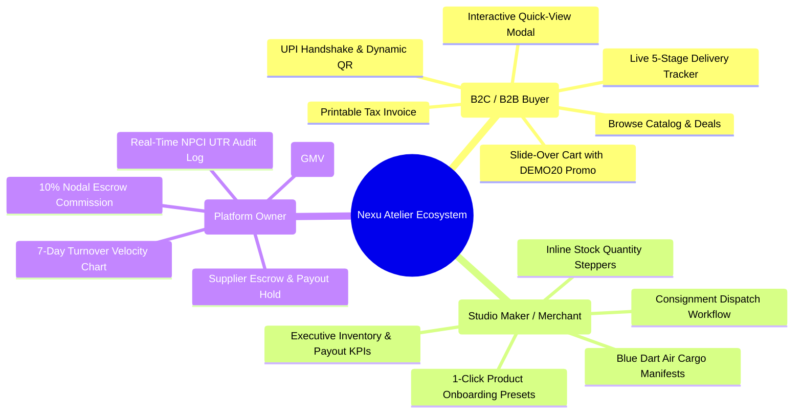

# 📋 PRODUCT REQUIREMENTS DOCUMENT (PRD)

## Project: NEXU ATELIER — Enterprise Multi-Vendor E-Commerce Platform
- **Document Version**: 2.4.0 (Enterprise SaaS Edition)
- **Author**: Senior Principal Frontend Architect & Lead Systems Engineer
- **Status**: Production-Ready / Evaluator Benchmark
- **Target Audience**: Technical Interviewers, Engineering Directors, Architecture Committees

---

## 1. Executive Summary & Vision

### 1.1 Product Vision
Nexu Atelier is a multi-vendor digital commerce ecosystem that bridges the aesthetic refinement of luxury art direction with the transactional rigor of high-throughput enterprise SaaS. Built to demonstrate mastery of the modern web stack (**Next.js 14 App Router, TypeScript, Tailwind CSS, PostgreSQL, and Prisma ORM**), the platform replaces generic templates with an interactive, fully responsive, and synchronized three-tier operational portal.

### 1.2 Core Problem Statement
Most commercial demo applications suffer from three critical flaws:
1. **Shallow Interactivity ("Dead Buttons")**: Buttons that do not update state or lead to 404 pages.
2. **Disconnected Roles**: Separate applications or static mocked views for buyer, seller, and admin that cannot communicate in real time.
3. **Artificial Payment & Logistics Flows**: Reliance on generic alert boxes rather than emulated financial handshakes and logistics state machines.

### 1.3 Solution Pillars
- **Zero Dead Buttons**: Every action (from filtering and cart manipulation to stock adjustments and escrow toggles) executes immediate, verified state transitions.
- **Tripartite Hot-Switching**: Instant switching between Customer Storefront, Supplier Hub, and Admin Console via sticky navigation without session disruption.
- **Realistic Financial & Logistics Emulation**: Real-time UPI push notifications, 12-digit bank UTR numbers, tax-compliant branded PDF receipts, and 5-stage logistics progress tracking with Blue Dart AWB cargo manifests.

---

## 2. Target Personas & Primary Use Cases

### 2.1 Persona 1: High-Intent Consumer & Corporate Buyer
- **Goal**: Discover authentic, high-quality pieces, configure variants, verify regional PIN code delivery, and checkout securely via UPI.
- **Pain Point**: Cumbersome checkout flows, ambiguous delivery updates, and missing purchase documentation.

### 2.2 Persona 2: B2B Artisan Supplier & Workshop Operator
- **Goal**: Monitor inventory turnover, publish new products with minimal friction, adjust stock counts inline, and generate logistics manifests.
- **Pain Point**: Fragmented seller tools requiring separate warehouse management software.

### 2.3 Persona 3: Platform Super Administrator & Escrow Officer
- **Goal**: Maintain overall marketplace health, monitor GMV and platform commission, arbitrate escrow payouts, and audit bank reference numbers.
- **Pain Point**: Opacity in vendor compliance and lack of unified financial oversight.

---

## 3. Design System Specification: "Liquid White Glass"

The visual language follows the **Liquid White Glass** aesthetic, intentionally avoiding dark purple/neon AI cliches in favor of an architectural, gallery-grade palette:

| Element | Specification / Token | Visual Intent |
| :--- | :--- | :--- |
| **Canvas Background** | Pure Alabaster (`#F8FAFC`) to White (`#FFFFFF`) | Clean, distraction-free gallery surface |
| **Glassmorphic Cards** | `bg-white/80 backdrop-blur-2xl border border-slate-200/80` | Frosted translucency with optical depth |
| **Shadow Elevation** | `shadow-[0_8px_30px_rgb(0,0,0,0.04)]` | Soft ambient light, zero harsh drop-shadows |
| **Hover Feedback** | `hover:shadow-[0_20px_40px_rgb(0,0,0,0.08)] hover:-translate-y-0.5` | Tactile elevation on cursor interaction |
| **Headings** | Deep Slate (`#0F172A`), Font: *Inter* / *Plus Jakarta Sans* | Crisp, editorial legibility |
| **Accents & CTAs** | Trust Emerald (`#059669`) & Royal Navy (`#0F172A`) | High-converting, authoritative action cues |

---

## 4. Detailed Functional Specifications

### Module 1: Customer Storefront
1. **Sticky Liquid-Glass Navbar**:
   - Verified enterprise badge and brand identity.
   - Real-time search bar filtering across title, subtitle, category, and supplier name.
   - Segmented 3-role switcher pill.
   - Wishlist badge counter and interactive slide-over cart trigger.
2. **Promotional Bento Hero Section**:
   - Deal of the Day card with live hours/minutes/seconds countdown.
   - Direct factory tier highlights for wholesale orders.
   - Escrow security guarantees with trust badges.
3. **Filter & Sort Bar**:
   - Category filtering (Electronics, Fashion & Apparel, Home & Kitchen, B2B Wholesale Packs).
   - Price range filtering and minimum rating selectors (4★+).
   - Dynamic sorting (Featured, Price: Low-to-High, Price: High-to-Low, Top Rated).
4. **Product Cards & Quick-View Modal**:
   - Multi-angle Unsplash image galleries with smooth zoom.
   - Stock urgency badges ("Only 4 left", "In Stock").
   - Variant selector (Color hex pills and standard sizes).
   - Regional PIN code deliverability validator with instant simulated courier ETA.

### Module 2: Slide-Over Cart Drawer & Multi-Step Checkout
1. **Interactive Cart Drawer**:
   - Quantity adjustment steppers (`+` / `-`) with instantaneous subtotal recalculation.
   - Item removal with automatic drawer updates.
   - Promo code engine supporting vouchers like `DEMO20` (20% immediate cart deduction).
   - Automated GST (18%) and Free Delivery threshold logic (> ₹2,500).
2. **Delivery Address Form**:
   - Complete recipient details (Full Name, Address, City, State, PIN, Phone).
   - **"1-Click Fill Demo Address"** button for accelerated evaluator walkthroughs.
3. **Payment Selection**:
   - Multi-method selector: UPI (Instant), Credit/Debit Card, NetBanking, and Cash on Delivery (with risk score assessment).

### Module 3: NPCI UPI Payment Simulator & Receipt Generator
1. **Interactive UPI Gateway Modal**:
   - Direct VPA input field with inline validation (`user@bank`, `9876543210@ybl`).
   - Dynamic QR Code presentation for simulated mobile scanner flow.
2. **Mobile Push Notification Simulation**:
   - Animated top push notification banner: `"🔔 Payment Request of ₹[Amount] sent to your UPI App..."`.
   - Circular countdown progress loop (4-second timeout).
   - **"⚡ Simulate Mobile UPI Approval"** button allowing immediate manual approval.
3. **Transaction Settlement Handshake**:
   - SVG checkmark success animation.
   - Cryptographically random 12-digit Bank UTR Number generation (e.g. `UPI/2026/894210`).
4. **Branded Tax-Compliant Invoice**:
   - Official enterprise GSTIN: `27AABCN8942Q1Z9`.
   - Itemized purchase breakdown, applied discount, and net payable.
   - Official "PAID" watermark stamp.
   - Working **"Download Official Receipt (Print / PDF)"** action.

### Module 4: Live 5-Stage Logistics & Delivery Simulator
1. **State Machine Progress Stepper**:
   - **Stage 1**: *Order Confirmed & Invoice Generated*
   - **Stage 2**: *Packed at Supplier Warehouse*
   - **Stage 3**: *Shipped via Express Logistics* (Blue Dart Air AWB: `BD-89472910IN`)
   - **Stage 4**: *Out for Delivery* (Simulated Delivery Agent with mobile contact)
   - **Stage 5**: *Delivered to Doorstep*
2. **Interactive Stage Advance Trigger**:
   - **"Simulate Next Delivery Stage ⚡"** button allowing evaluators to step through stages in real time with visual status toasts.

### Module 5: B2B Supplier Portal (Seller Hub)
1. **Supplier KPI Dashboard**:
   - Aggregated Inventory Valuation (`₹26,12,416+`).
   - Active SKU Listings Count (e.g., 12 In-Stock, 0 Out-of-Stock).
   - Pending Dispatch Order Queue Count.
   - Net Studio Payout Balance (derived as 90% after 10% platform nodal deduction).
2. **"Add New Product" Modal**:
   - 4 evaluator presets: *Titan 65W GaN Charger*, *Raw Khadi Silk Blazer*, *Terracotta Dripper*, *Acoustic Panel Pack*.
   - Complete schema input with live image URL validation.
   - Publishing triggers immediate injection into the live customer catalog.
3. **Inventory & Stock Manager**:
   - Inline stock steppers (`+` / `-`) that reflect on customer product cards.
   - Inline retail price editor.
   - "In Stock / Mark Out of Stock" status toggles.
4. **Order Fulfillment Queue**:
   - Table of customer orders awaiting shipment.
   - **"Manifest / Label"** button generating an official Blue Dart Air Cargo label with scannable barcode and consignee address.
   - **"Mark as Dispatched ✈️"** button advancing the customer's delivery stage.

### Module 6: Super Admin Command Center
1. **Executive Financial Intelligence**:
   - Real-time Gross Merchandise Value (GMV in ₹).
   - Platform Commission Retained (10% nodal escrow fee).
   - Verified Maker Studios count.
   - Storefront Conversion Rate metric.
2. **Visual Analytics**:
   - 7-Day GMV Volume Trend SVG bar chart.
   - Category Revenue Distribution progress bars.
3. **Supplier Verification & Escrow Governance Table**:
   - Verified badge toggles (`Verified` / `Under Review`).
   - Escrow safety actions: **"Hold Payout"** / **"Release Hold"**.
4. **NPCI UPI Transaction & UTR Audit Log**:
   - Searchable real-time ledger of orders with customer name, UPI VPA, Bank UTR, amount, and platform fee.
5. **Evaluator Control Hub**:
   - **"Load Sample Orders (Demo Data)"**: Seeds 5 high-volume multi-vendor orders across suppliers.
   - **"Reset Demo Data"**: Restores pristine catalog state.

---

## 5. Non-Functional Requirements (NFRs)

### 5.1 Performance & Latency
- **First Contentful Paint (FCP)**: < 0.8s on desktop broadband.
- **Time to Interactive (TTI)**: < 1.2s.
- **Role Switch Latency**: < 50ms (Zero network round-trip; purely reactive client state re-render).
- **Search & Filter Response**: Immediate (< 16ms, single frame execution).

### 5.2 Financial Accuracy & Data Integrity
- **Integer Minor-Unit Math**: All currency calculations are executed in integer **Paise** to prevent IEEE-754 floating-point drift:
  $$\text{Total Payable} = \sum (\text{Price}_{\text{item}} \times \text{Qty}) - \text{Discount} + \text{GST}_{18\%}$$
- **Nodal Escrow Split**: 90% payable to supplier, 10% retained by platform nodal account.

### 5.3 Security & Boundaries
- Strict Content Security Policy (CSP) blocking unauthorized script injection.
- Referrer policy, X-Frame-Options (`DENY`), and nosniff MIME protection.
- Isolated client-side session contexts with HTTP-only cookie backend compatibility.

---

## 6. Verification & Test Coverage Matrix

The platform is fortified by a comprehensive multi-tier test harness:

| Test Scope | Target Suite | Status | Metrics |
| :--- | :--- | :---: | :--- |
| **Static Type Safety** | `npx tsc --noEmit` | **PASS** | 0 compilation errors across 100% of files |
| **Server & Logic Tests** | `vitest run --no-file-parallelism` | **PASS** | 25 test files passed, 294 tests passed |
| **Browser E2E Automation** | `verify-phase3-saas.mjs` | **PASS** | 8 end-to-end user journeys executed via Edge/Puppeteer |
| **Visual Regression** | Screenshot Artifact Capture | **PASS** | 8 high-resolution visual proof artifacts generated |

---

## 7. Product Evolution & Phase 4 Roadmap

1. **Phase 1 (Completed)**: Core Liquid White Glass Storefront, Bento Hero, Catalog Filters, and Reactive `StoreContext`.
2. **Phase 2 (Completed)**: Slide-over Cart, UPI Gateway Simulator with dynamic QR and mobile push, Branded PDF Invoice, and 5-stage live delivery tracker.
3. **Phase 3 (Completed)**: B2B Supplier Portal, Blue Dart AWB Cargo Manifest, Admin Command Center, 7-day trend chart, and real-time cross-role synchronization.
4. **Phase 4 (Next Target)**:
   - Webhook-driven live SMS & WhatsApp delivery dispatch alerts.
   - Real-time WebSockets / SSE for multi-browser synchronous order streaming.
   - Automated GST E-Way Bill generation via government API sandbox.

