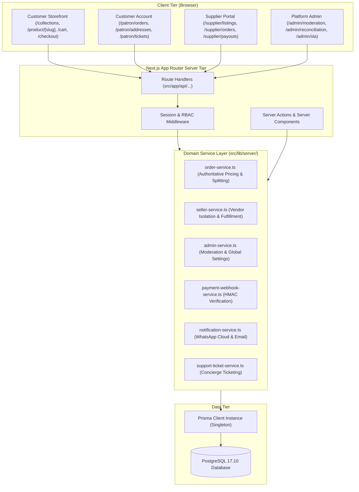

# NEXU ATELIER — System Architecture & Engineering Blueprint

**Document Revision:** 2.0.0  
**Timestamp:** November 2026  
**Status:** Authoritative Engineering Document  

---

## 1. Verified Technology Stack

| Layer | Component | Version | Role in Architecture |
| :--- | :--- | :--- | :--- |
| **Framework** | Next.js (App Router) | `14.2.18` | Server components, streaming SSR, API route handlers |
| **UI Library** | React | `18.3.1` | Declarative UI, client interactivity, context providers |
| **Language** | TypeScript | `5.9.3` | End-to-end static type safety, strict null checking |
| **Styling** | Tailwind CSS | `3.4.17` | Utility-first styling with custom CSS design tokens |
| **ORM** | Prisma | `6.4.1` (5.x API compatible) | Relational query builder, schema migrations, type generation |
| **Database** | PostgreSQL | `17.10` (x86_64) | Relational ACID storage, foreign keys, compound indexes |
| **Testing** | Vitest | `2.1.8` | Integration & unit test runner with isolated transactions |
| **Icons & Motion** | Lucide React & Framer Motion | `0.475.0` / `11.18.2` | Minimalist editorial icons and fluid micro-interactions |

---

## 2. Multi-Tier Architecture Diagram

---

## 3. Core Architectural Subsystems

### 3.1 Server-Authoritative Commerce & Pricing
The client application is treated as untrusted presentation. When checkout is invoked:
1. Client submits product IDs, variant SKUs, quantities, address ID, and optional coupon code.
2. The server loads genuine product records directly from PostgreSQL.
3. Quantities are validated against live inventory with atomic row-level decrements.
4. Line totals, discounts, shipping fees, and taxes are computed strictly in integer paise.
5. Client-supplied amounts are ignored.

### 3.2 Multi-Vendor Order Routing & Isolated Shipments
- An `Order` record represents the single customer-facing entity.
- The server groups items by `product.vendorId`.
- For each unique vendor:
  - Line items (`OrderItem`) are stamped with `vendorId` and `vendorName`.
  - A dedicated `Shipment` record is created with distinct carrier and tracking number (Blue Dart).
  - An escrow ledger entry (`VendorPayout`) is created deducting the 10% platform commission.
- Vendor APIs scope queries strictly to `where: { vendorId: sellerId }`.

### 3.3 Security, Anti-IDOR & Authentication
- Password hashing uses PBKDF2 with SHA-512 and 210,000 iterations.
- Primary authentication and step-up verification uses WhatsApp Cloud API (v21.0) OTP with 5-minute expiry, 3-attempt lockout, and 60-second cooldown. SMS OTP is prohibited.
- Anti-IDOR guardrails enforce ownership on every mutation: `where: { id, customerId }` for patrons and `where: { id, vendorId }` for sellers.

---

## 4. Scalability & Operational Integrity
- **Database Connection Sizing:** Configured with transaction timeouts (`maxWait: 5000ms`, `timeout: 10000ms`) to protect against connection exhaustion.
- **Audit Logging:** Every administrative action, seller state transition, and order cancellation creates an immutable row in `AuditEvent`.
- **Idempotency:** Webhook processing and checkout requests require unique idempotency keys to prevent duplicate operations.

