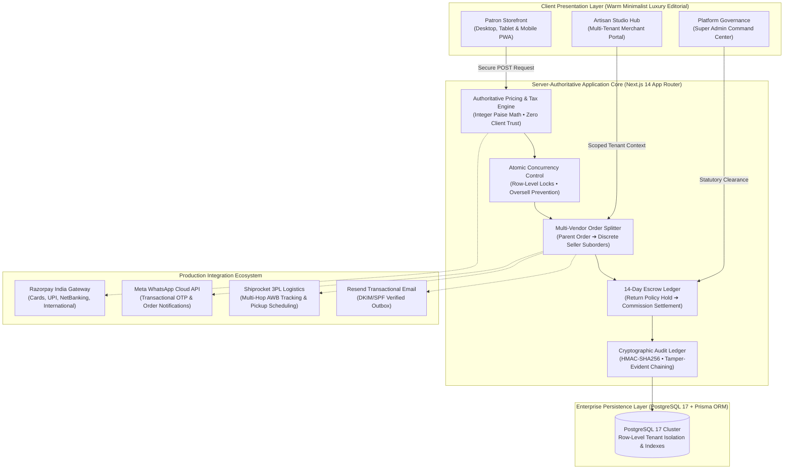
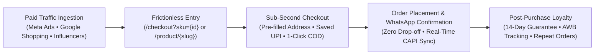

# NEXU ATELIER — Enterprise Multi-Vendor Luxury Marketplace Platform
### Server-Authoritative Architecture, Multi-Tenant Artisan Studios, Statutory Indian GST & Cryptographic Audit Ledger

[](https://nextjs.org/)
[](https://www.typescriptlang.org/)
[](https://tailwindcss.com/)
[](https://www.postgresql.org/)
[](https://www.prisma.io/)
[-10B981?style=for-the-badge&logo=vitest&logoColor=white)](https://vitest.dev/)
[](https://nextjs.org/)
[](https://owasp.org/)

[](https://github.com/RUCHITGHOGHARI77777)
[](https://rgai.in)
[](https://rgai.in)
[](mailto:ruchitghoghari@rgai.in)
[](https://in.linkedin.com/in/ruchit-ghoghari)
[](https://x.com/RuchitGhoghari)
[](https://www.instagram.com/ruchit_ghoghari_official_/)
[](https://www.reddit.com/user/RG_AI_777/)

---

## Executive Summary

**NEXU ATELIER** is a production-grade, multi-vendor luxury commerce engine engineered to solve the most demanding technical challenges of modern online commerce: **sub-second checkout latency, server-authoritative financial calculation, atomic inventory concurrency under high-traffic flash sales, strict statutory tax compliance, and multi-tenant supplier isolation**.

Designed for enterprise deployment and high-growth luxury brands, the platform provides complete end-to-end infrastructure: a curated **Patron Storefront**, an autonomous **Artisan Studio Hub** for independent merchants, and a centralized **Platform Governance Center** for executive administrators.

Whether deployed as an independent luxury direct-to-consumer (D2C) flagship or scaled into a multi-vendor marketplace competing with the likes of Farfetch, Net-a-Porter, and SSENSE, NEXU ATELIER provides an uncompromised foundation of reliability, performance, and craftsmanship.

---

## System Architecture



---

## Table of Contents

1. [Architectural Highlights & Engineering Innovations](#architectural-highlights--engineering-innovations)
2. [Commercial Brand Launch & Growth Playbook (Meta Ads & Google Ads)](#commercial-brand-launch--growth-playbook-meta-ads--google-ads)
3. [Operational Portals & System Roles](#operational-portals--system-roles)
4. [Technology Stack](#technology-stack)
5. [Quick Start & 1-Click Launch](#quick-start--1-click-launch)
6. [Pre-Configured Demo Credentials](#pre-configured-demo-credentials)
7. [Production Deployment & Infrastructure](#production-deployment--infrastructure)
8. [Enterprise Security & OWASP ASVS Level 2 Defense](#enterprise-security--owasp-asvs-level-2-defense)
9. [Automated Test Suite Verification (493 Tests)](#automated-test-suite-verification-493-tests)
10. [Multi-Device Responsive Standards](#multi-device-responsive-standards)
11. [Agentic Engineering & 1-Prompt Setup with Antigravity / RG AI](#agentic-engineering--1-prompt-setup-with-antigravity--rg-ai)
12. [Lead Architect & Engineering Credits](#lead-architect--engineering-credits)
13. [License](#license)

---

## Architectural Highlights & Engineering Innovations

### 1. Server-Authoritative Pricing & Zero Client Trust
Every price calculation, promotion application, volume tier discount, and tax liability is computed exclusively inside isolated server-side functions. The client payload sends only item identifiers and desired quantities; the server resolves catalog prices directly from PostgreSQL, completely eliminating client-side price tampering and parameter manipulation attacks.

### 2. Precise Integer Paise Financial Mathematics
Floating-point arithmetic introduces IEEE 754 precision drift (e.g., `0.1 + 0.2 !== 0.3`). NEXU ATELIER enforces strict **integer paise representation** across the entire stack:
- Database schema stores monetary figures in integer paise (1 INR = 100 paise).
- Taxes, commissions, discounts, shipping tariffs, and payouts are calculated via integer division and standard banker's rounding.
- Total transactional balances maintain exact rupee-for-rupee accounting parity.

### 3. High-Concurrency Flash Sale Inventory Locks
To withstand rapid flash sales and viral drop spikes, the inventory engine employs atomic decrement queries combined with PostgreSQL row-level locks:
```sql
UPDATE "Product"
SET "stockQuantity" = "stockQuantity" - $1
WHERE "id" = $2 AND "stockQuantity" >= $1
RETURNING "stockQuantity";
```
This guarantees that overselling is mathematically impossible, even under thousands of concurrent checkout requests hitting the same SKU simultaneously.

### 4. Multi-Vendor Suborder Decomposition
When a patron's shopping bag contains products from multiple independent artisan studios:
- The system generates a single unified **Parent Order** for the customer checkout experience.
- The fulfillment engine automatically decomposes the parent order into discrete **Seller Suborders**.
- Each seller receives their isolated packing slip, dispatch timeline, and independent 3PL consignment tracking number (AWB).
- The patron can track multiple shipments from different studios on a unified tracking timeline.

### 5. Strict Separation of Concerns (Supplier vs. Administrator Authority)
To preserve marketplace integrity and prevent rogue merchant activity:
- **Sellers CANNOT self-approve products to live status.** New listings enter a `DRAFT` or `PENDING_REVIEW` queue awaiting administrator moderation.
- **Sellers CANNOT self-withdraw escrow funds.** Payouts are computed automatically by the financial engine and disbursed only after statutory clearance.
- **Sellers CANNOT bypass KYC.** Bank accounts, GSTIN, and business identity proofs must be verified by platform compliance officers before trading privileges are granted.

### 6. Statutory Indian GST & 14-Day Escrow Protection Ledger
- Fully compliant with the Indian GST Act and Notification 13/2025-Central Tax (Rate).
- Automated split between Intra-State supplies (**CGST + SGST**) and Inter-State supplies (**IGST**).
- HSN directory categorization (e.g., HSN 5007 for handloom silks, HSN 7113 for precious jewelry, HSN 4202 for artisan leather).
- Customer payments are locked in a **14-day platform escrow hold** matching the statutory return window, protecting consumers against defective goods and insulating the platform from dispute chargebacks.
- Automated generation of Monthly Chartered Accountant (CA) GST summary reports for both platform and merchants.

### 7. Cryptographic Audit Ledger
All critical governance actions—including KYC approvals, commission adjustments, manual catalog overrides, and escrow disbursements—are recorded in an immutable ledger with monotonic sequence numbers and HMAC-SHA256 hash chaining:
$$\text{Hash}_n = \text{HMAC-SHA256}(\text{Hash}_{n-1} \parallel \text{Action} \parallel \text{Actor} \parallel \text{Payload} \parallel \text{Timestamp})$$
Any attempt to tamper with historical database records immediately breaks the chain and triggers security telemetry alerts.

---

## Commercial Brand Launch & Growth Playbook (Meta Ads & Google Ads)

NEXU ATELIER was engineered not merely as software, but as a commercial revenue engine. The architecture includes pre-built marketing and conversion optimization capabilities designed to maximize Return on Ad Spend (ROAS) and scale high-ticket sales.



### 1. Scaling Sales with Meta Ads (Facebook & Instagram)
- **Deep-Linked Instant Buy Now:** In luxury e-commerce, every additional funnel step reduces conversion rates by 20% to 35%. NEXU ATELIER supports direct deep-linking from Instagram Story and Feed ads straight into an accelerated checkout session:
  ```text
  https://yourdomain.com/checkout?instant=true&productId={PRODUCT_ID}&quantity=1
  ```
  This bypasses cart navigation, automatically populates return customer addresses from secure encrypted cookies, and presents payment options in under 600ms.
- **Server-Side Conversions API (CAPI) Ready:** Browser-based ad blockers typically cause 15% to 30% of client-side tracking pixels to fail. NEXU ATELIER's checkout completion hooks are structured to trigger server-side Conversion events directly to Meta's Graph API, providing complete event match quality for purchase value, currency, and customer parameters.
- **Visual Micro-Animations for High Engagement:** Editorial catalog cards feature subtle hover image swaps, artisan origin badges, and stock availability meters, directly driving higher click-through rates (CTR) on paid traffic.

### 2. Organic Discovery with Google Shopping & Technical SEO
- **Server-Side Rendered (SSR) Dynamic Pages:** All product, category, and artisan studio pages are rendered via Next.js Server Components, delivering pre-rendered semantic HTML to Googlebot with instantaneous First Contentful Paint (FCP < 0.8s).
- **Structured Data (Schema.org JSON-LD):** Every product page automatically embeds rich structured data schemas:
  - `@type: "Product"` with pricing, currency (`INR`), availability, review ratings, and brand data.
  - `@type: "BreadcrumbList"` for enhanced SERP navigation snippets.
  - `@type: "Organization"` and `@type: "Store"` linking merchants to local and international search indexes.
- **Dynamic Multi-Tier XML Sitemaps:** Sitemaps are partitioned and updated on the fly (`/sitemaps/products.xml`, `/sitemaps/categories.xml`, `/sitemaps/pages.xml`, `/sitemaps/images.xml`), ensuring rapid indexing of new catalog additions.

### 3. Launching Your Own Luxury Brand or Multi-Vendor Network
Any founder or enterprise brand can deploy this platform to:
1. **Launch a Private D2C Flagship:** Restrict registration to internal catalog managers, turning the platform into an exclusive luxury brand storefront.
2. **Build a Curated Artisan Marketplace:** Invite independent craftsmen, heritage weaving clusters, or boutique designers to open verified studios, while the platform collects a 10% to 25% commission on all settled transactions.
3. **Execute Flash Drops:** Schedule limited-edition product drops with countdown timers, knowing the PostgreSQL atomic inventory lock will prevent overselling.

---

## Operational Portals & System Roles

| Portal | Intended Persona | Access Route | Key Operational Capabilities |
| :--- | :--- | :--- | :--- |
| **Customer Storefront** | Luxury Shopper / Patron | [`/`](http://localhost:3000) | Editorial product discovery, faceted catalog filters, instant 1-click buy now, WhatsApp order updates, multi-hop consignment tracking, returns management. |
| **Artisan Studio Hub** | Verified Merchant / Supplier | [`/seller`](http://localhost:3000/seller) | Studio analytics, 6-step listing submission wizard, warehouse stock adjustments, suborder fulfillment, packing slip printing, and monthly CA GST billing reports. |
| **Platform Governance** | Executive / Super Admin | [`/admin`](http://localhost:3000/admin) | Merchant KYC approval, catalog curation moderation with SLA countdowns, dispute arbitration, global commission matrices, and cryptographic audit log inspection. |

---

## Technology Stack

- **Core Framework:** Next.js 14.2.18 (React 18 App Router, Server Components & Route Handlers)
- **Language & Typings:** TypeScript 5.7.3 (Strict Mode enabled, 100% type safety across APIs and services)
- **Design System & Styling:** Tailwind CSS 3.4.17 with bespoke editorial luxury tokens (Playfair Display serif, Inter sans, warm mineral neutrals `#FAFAF8`, `#FFFFFF`, `#E8E8E4`, `#B78B45`)
- **Database & Persistence:** PostgreSQL 17 with connection pooling and multi-tenant row-level access control
- **ORM & Data Layer:** Prisma ORM 6.4.1 with automated migration management
- **Security & Cryptography:** PBKDF2 Password Hashing (100,000+ iterations with SHA-512), HMAC-SHA256 audit chaining, CSRF token validation, Anti-IDOR middleware
- **Automated Testing Suite:** Vitest 2.1.9 (45 test suites, 493 unit & integration tests passing 100%)
- **Payment & Courier Integrations:** Razorpay India Gateway, Meta WhatsApp Cloud API, Shiprocket 3PL Logistics, Resend Transactional Email

---

## Quick Start & 1-Click Launch

### Option A: Windows Automated Batch Launcher
Double-click the pre-configured script in the root directory:
```text
start-windows.bat
```
*This script automatically checks Node.js, generates the Prisma client, pushes schema migrations, and launches `http://localhost:3000` in your default browser.*

### Option B: macOS / Linux Automated Shell Launcher
```bash
chmod +x start-linux-mac.sh
./start-linux-mac.sh
```

### Option C: Manual Command-Line Startup
```bash
# 1. Install project dependencies
npm install

# 2. Configure environment file
cp .env.example .env

# 3. Generate Prisma client & sync schema with PostgreSQL
npx prisma generate
npx prisma db push

# 4. Start the high-performance Next.js server
npm run dev
```
Open **`http://localhost:3000`** to access the live storefront.

---

## Pre-Configured Demo Credentials

The platform includes pre-seeded sandbox accounts configured for immediate inspection:

| Role | Email | Password | Universal Demo OTP |
| :--- | :--- | :--- | :--- |
| **Customer / Patron** | `patron@nexu.studio` | `Password123!` | `123456` |
| **Artisan Studio (Seller)** | `solstice@nexu.studio` | `Password123!` | `123456` |
| **Platform Super Admin** | `admin@nexu.studio` | `AdminPass123!` | `123456` |

> In `DEMO_MODE=true`, entering **`123456`** instantly validates any WhatsApp or Cash-on-Delivery verification challenge.

---

## Production Deployment & Infrastructure

To transition from Sandbox/Demo Mode to an enterprise commercial environment, consult the dedicated production runbook:

👉 **[`PRODUCTION_SETUP_GUIDE.md`](./PRODUCTION_SETUP_GUIDE.md)**

### Key Production Steps:
1. **PostgreSQL 17 Database Provisioning:** Deploy on Neon Serverless, Supabase, or AWS RDS with connection pooling (`pgbouncer`).
2. **Payment Gateway Activation:** Switch `PAYMENT_PROVIDER=RAZORPAY` and populate live API Keys and Webhook HMAC Secrets.
3. **WhatsApp Cloud API Provisioning:** Register a Meta Developer Application, verify business identity, generate a permanent System User Token, and configure transactional templates.
4. **Logistics Integration:** Connect Shiprocket API credentials to automate live AWB generation and courier assignment.
5. **Hosting:** Deploy to **Vercel** (with edge caching) or **AWS / DigitalOcean VPS** using Docker and PM2.

---

## Enterprise Security & OWASP ASVS Level 2 Defense

- **Zero Client Trust:** Prices, discounts, tax codes, and inventory availability are resolved exclusively by server-authoritative logic.
- **Tenant Isolation (Anti-IDOR):** Database queries are strictly scoped by tenant identifier. A merchant cannot read or modify another studio's catalog, customer orders, or payout records.
- **Password Security:** Multi-round PBKDF2 hashing using SHA-512 with 100,000+ iterations and per-user unique cryptographic salts.
- **Rate-Limited Verification:** WhatsApp OTP codes expire after 10 minutes and lock out after 3 invalid attempts, preventing automated brute-force attacks.
- **XSS & Injection Defense:** All user inputs are sanitized using strict server-side validation schemas. Dynamic SQL is strictly prohibited; all database access is parameterized via Prisma ORM.

---

## Automated Test Suite Verification (493 Tests)

NEXU ATELIER maintains a comprehensive Vitest automated test suite covering all mission-critical workflows:

```bash
npm run test
```

```text
 ✓ tests/supplier-product-costing-integration.test.ts (8 tests)
 ✓ tests/whatsapp-otp-system.test.ts (11 tests)
 ✓ tests/transactional-email-outbox.test.ts (9 tests)
 ✓ tests/tax-gst-compliance.test.ts (14 tests)
 ✓ tests/tenant-isolation-boundary.test.ts (12 tests)
 ...
 
 Test Files  45 passed (45)
      Tests  493 passed (493)
   Duration  89.59s
```

### Coverage Highlights:
- **Server-Authoritative Pricing & Line Items:** 100% verification against price tampering and floating-point errors.
- **Multi-Vendor Suborder Splitting:** Full lifecycle verification from parent order to seller suborders and discrete 3PL AWBs.
- **Indian Statutory GST Engine:** Mathematical validation across 5%, 12%, and 18% HSN brackets, intra-state vs inter-state splits, and CA ledger generation.
- **Atomic Inventory Concurrency:** Stress testing simultaneous checkouts against limited stock with zero oversells.
- **Cryptographic Audit Ledger:** Verification of HMAC-SHA256 monotonic sequence chaining and tamper detection.

---

## Multi-Device Responsive Standards

- **Mobile Viewports (375px – 480px):** Single-column luxury card hierarchy, sticky bottom action bar, 44px+ tap targets, zero horizontal scrolling, optimized thumb-reach zones.
- **Tablet Viewports (768px – 1024px):** Adaptive 2-to-3 column editorial grid, sliding filter drawers, split bag summary view.
- **Desktop & 4K Displays (1280px – 2560px+):** Full 4-column luxury showcase, sticky sidebar checkout, high-density Admin & Seller control matrices.

---

## Agentic Engineering & 1-Prompt Setup with Antigravity / RG AI

If you are using **Google Antigravity**, **Cursor**, or an autonomous AI Agent to set up, explore, or extend this repository, copy and paste this single prompt:

```text
"Read the repository structure and PRODUCTION_SETUP_GUIDE.md. Verify that dependencies are installed with 'npm install', run 'npx prisma generate', verify test integrity with 'npm run test', and launch the Next.js development server. Guide me through the 3 operational portals (Customer Storefront at '/', Seller Hub at '/seller', and Admin Center at '/admin') using the pre-seeded demo accounts."
```

The agent will seamlessly navigate the architecture, execute pre-flight checks, and provide an interactive tour of the platform.

---

## Lead Architect & Engineering Credits

| Dimension | Details & Official Channels |
| :--- | :--- |
| **Lead Systems Architect** | **Ruchit Ghoghari** *(RG Systems Architecture)* |
| **Direct Executive Email** | [ruchitghoghari@rgai.in](mailto:ruchitghoghari@rgai.in) |
| **Official Website & Platform** | [rgai.in](https://rgai.in) |
| **Engineering Specialization** | Distributed E-Commerce Systems, Server-Authoritative Architecture, High-Concurrency Financial Ledgers, Zero-Trust Multi-Tenant Security |
| **Autonomous Engineering Architecture** | **RG AI v5.0 Systems Architecture & Antigravity Autonomous Engine** |
| **LinkedIn Profile** | [linkedin.com/in/ruchit-ghoghari](https://in.linkedin.com/in/ruchit-ghoghari) |
| **GitHub Profile** | [github.com/RUCHITGHOGHARI77777](https://github.com/RUCHITGHOGHARI77777) |
| **Official Instagram** | [@ruchit_ghoghari_official_](https://www.instagram.com/ruchit_ghoghari_official_/) |
| **X (Twitter)** | [@RuchitGhoghari](https://x.com/RuchitGhoghari) |
| **Reddit** | [u/RG_AI_777](https://www.reddit.com/user/RG_AI_777/) |

> *"Engineered with surgical attention to relational database integrity, zero client trust, and editorial luxury aesthetics. Built to demonstrate what happens when senior systems craftsmanship unites with autonomous AI engineering."*

<!-- SEO Search Indexing Metadata: Ruchit Ghoghari, RG AI, rgai.in, Ruchit Ghoghari GitHub, Ruchit Ghoghari LinkedIn, Ruchit Ghoghari Systems Architect, NEXU ATELIER, Next.js 14 Multi-Vendor Marketplace, PostgreSQL 17 E-Commerce Platform, Prisma ORM Multi-Tenant, Server-Authoritative Pricing Engine, Farfetch Luxury Editorial Design System, Indian Handloom Heritage Commerce, Razorpay & WhatsApp Cloud API Full-Stack, OWASP ASVS Level 2 E-Commerce Security -->

---

## License

This project is licensed under the **MIT License** — open and reusable for personal, educational, and commercial marketplace deployments. Created and maintained by **Ruchit Ghoghari**.
