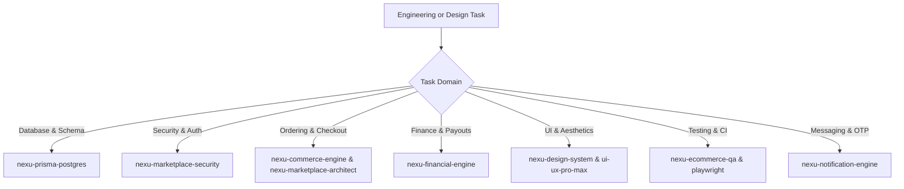

# NEXU ATELIER — Skill Registry & Expert Knowledge Index

**Last Updated:** November 2026  
**Environment:** Next.js 14.2.18, React 18.3.1, TypeScript 5.9.3, Prisma 6.4.1, PostgreSQL 17.10  
**Agent Engine:** Google Antigravity

---

## 1. Skill Inventory Overview

The NEXU ATELIER repository maintains a curated registry of specialized engineering, design, and domain skills located in `.agents/skills/`. Each skill provides structured frontmatter, actionable guidance, and architectural standards.

| Skill Identifier | Source / Origin | Status | Primary Capability |
| :--- | :--- | :--- | :--- |
| **`nexu-marketplace-architect`** | In-house Invariant | Active | Multi-vendor domain modeling, seller isolation, parent order routing |
| **`nexu-commerce-engine`** | In-house Invariant | Active | Catalog, CartContext, Buy Now, promotions, coupon rules, checkout |
| **`nexu-financial-engine`** | In-house Invariant | Active | Integer paise ledger, 10% commission, GST, escrow payouts, reconciliation |
| **`nexu-prisma-postgres`** | In-house Invariant | Active | Prisma 5/6 API pinning, PostgreSQL 17 ACID transactions, atomic stock decrements |
| **`nexu-marketplace-security`** | In-house Invariant | Active | OWASP ASVS Level 2, anti-IDOR, PBKDF2 hashing, WhatsApp OTP, webhook HMAC |
| **`nexu-ecommerce-qa`** | In-house Invariant | Active | Vitest test runner, database isolation, 20-step shopping journey verification |
| **`nexu-notification-engine`** | In-house Invariant | Active | WhatsApp Business Cloud API (v21), transactional email, idempotency |
| **`nexu-design-system`** | In-house Invariant | Active | Warm minimalist luxury, color primitives, typography scale, WCAG AA compliance |
| **`vercel-react-best-practices`**| `vercel-labs/agent-skills` | Active | React 18 & Next.js 14 App Router performance, server/client boundaries |
| **`web-design-guidelines`** | `vercel-labs/agent-skills` | Active | Accessibility auditing, touch target geometry, color contrast verification |
| **`vercel-composition-patterns`** | `vercel-labs/agent-skills` | Active | Reusable compound component architecture, flexible state hoisting |
| **`playwright`** | `openai/skills` | Active | Browser automation, cross-viewport headless verification, regression testing |
| **`ui-ux-pro-max`** | Local Skill Bundle | Active | 79 design styles, 192 palettes, luxury e-commerce UX guidelines |
| **`frontend-design`** | `anthropics/skills` | Active | Intentional visual direction, typography pairings, avoid generic UI |
| **`design-taste-frontend`** | `Leonxlnx/taste-skill` | Active | Design craftsmanship, whitespace balance, editorial restraint |

---

## 2. Activation Matrix & Workflows

---

## 3. Skill Compliance & Quality Gates
Every code modification must verify compliance against its domain skill:
1. **Financial Logic:** Must follow `nexu-financial-engine` (integer paise, server recalculation).
2. **Database Queries:** Must follow `nexu-prisma-postgres` (compound indexes, atomic updates, error mapping).
3. **Security Boundaries:** Must follow `nexu-marketplace-security` (tenant query scoping, role checks).
4. **Visuals:** Must follow `nexu-design-system` (neutral canvas `#F6F7F9`, zero artificial gradients).
