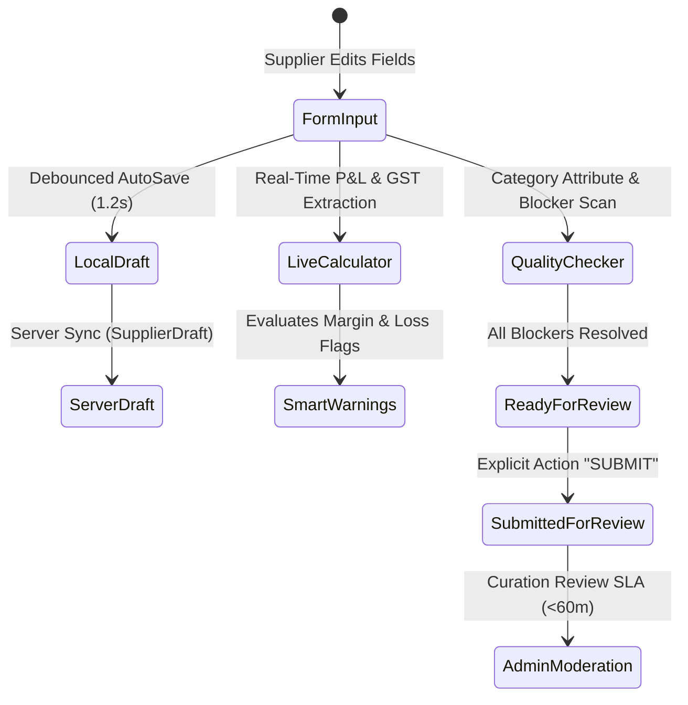

# NEXU ATELIER — Supplier Automation Architecture & Lifecycle Engineering

## 1. Automated Supplier Workflows

To eliminate manual overhead for independent studios and artisans, NEXU ATELIER implements end-to-end automation across the product and order lifecycles:

---

## 2. Automated Product Listing Capabilities

1. **Deterministic Unique SKU Generator:**
   - Automatically generates collision-free SKUs using studio prefix, category slug, and timestamp hash (`{PREFIX}-{CAT}-{RANDOM}`).
   - Detects duplicate variant SKUs client-side and inside `prisma.$transaction`.
2. **Auto-Draft & Progress Preservation:**
   - Every input change is debounced and synchronized across browser `localStorage` and PostgreSQL `SupplierDraft`.
   - If an artisan accidentally closes the tab or loses internet connection, the system detects the unsubmitted draft on reload and renders a prompt: *"Unfinished draft discovered. Resume or Discard?"*
3. **Automated Quality & Blocker Auditing:**
   - Analyzes title length ($\ge 3$ characters), narrative depth ($\ge 10$ characters), minimum image count ($\ge 1$ asset), and positive selling price.
   - Evaluates whether selling price exceeds break-even price.
4. **Smart Price & Margin Warnings:**
   - **Critical Loss Alert:** Flags if net contribution profit is negative.
   - **Below Break-Even:** Flags if price fails to cover direct production costs, packaging, inward freight, and marketplace fees.
   - **Low Margin Warning:** Warns if margin is below 10% (recommending $\ge 15\%$).
   - **High Shipping Warning:** Flags if outward courier exceeds 20% of unit price.

---

## 3. Inventory & Order Lifecycle Automation

### Atomic Stock Management
- **Order Placement:** Orders lock variant stock inside an ACID `prisma.$transaction`. If stock drops to or below `lowStockThreshold`, a `LOW_INVENTORY` alert is committed to `NotificationOutbox`.
- **Pre-Dispatch Cancellation:** When an order is cancelled before courier handover, stock is atomically incremented back to the active variant inventory.
- **Overselling Prevention:** Zero-trust database constraints reject orders where `stock - requestedQuantity < 0`.

### Order Fulfillment Automation
1. **New Order Notification:** Instant in-app alert + transactional email dispatched to studio owner upon customer payment capture.
2. **Acceptance & Packing:** One-click transition generates a printable GST-compliant branded packing slip and shipping document.
3. **Courier Booking & Dispatch:** When real courier credentials (e.g. Shiprocket/Delhivery) are active, system calls provider APIs to generate AWB and shipping labels. In mock mode, courier status is deterministic without fabricated delivery events.
4. **Customer Milestone Tracking:** Order status updates dispatch live tracking webhooks to `/track-order`.

---

## 4. Financial Settlement & Reporting Automation

- **Automated Payout Accruals:** Net seller payout is calculated per order item, excluding output GST and marketplace commissions.
- **Settlement Ledger:** Confirmed orders transition from `PENDING_SETTLEMENT` to `SETTLED` when the 7-day artisan replacement window elapses.
- **Reports:** Automated generation of daily, weekly, and monthly CSV statements distinguishing estimated gross revenue from finalized bank settlements.

