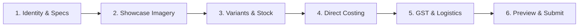

# NEXU ATELIER — Supplier Product Listing & Costing UX Architecture

## 1. Vision & Executive Summary

The NEXU ATELIER Supplier Product Creation & Economics Engine transforms complex commercial costing, statutory GST accounting, variant inventory control, and multi-tenant marketplace operations into an intuitive, guided, single-interface experience. Artisans, master weavers, and independent luxury studios can list items, calculate true production costs, preview official tax scenarios, and verify net earnings without needing external spreadsheets or financial calculators.

---

## 2. Multi-Step Guided Experience Architecture

The listing engine breaks product creation into six logical, self-contained stages:

### Step 1: Product Information & Specifications
- **Piece Identity:** Title, Subtitle, Brand / Artisan Guild, Category, Subcategory, Master SKU.
- **Craft Narrative:** Heritage story, fiber provenance, weaving technique, artisan bio.
- **Physical Specifications:** Material, dimensions, unit weight, care instructions.
- **Statutory Taxonomy:** Harmonized System of Nomenclature (HSN) with official CBIC mapping and notification references.
- **Search Metadata:** Discoverability tags and keywords for faceted customer browsing.

### Step 2: Showcase Imagery & Merchandising
- Multi-image upload supporting up to 8 high-resolution showcase assets.
- Slot 1 designated as Primary Hero (clean white canvas, 4:5 luxury aspect ratio).
- Real-time drag/drop reordering, client-side format validation (JPEG, WebP, PNG), and thumbnail previews.

### Step 3: Variants & Stock Control
- Discrete SKU matrix generation (`{MASTER_SKU}-VAR-{N}` or custom colorway/size identifiers).
- Variant types: `COLOR`, `SIZE`, `MATERIAL`, `STYLE`.
- Individual unit stock allocation and low-stock notification threshold.
- Variant-wise additional pricing and direct unit cost overrides.

### Step 4: Direct Cost Input & P&L Calculator
- **Two-Column Responsive Architecture:**
  - **Left Column (Inputs):** Categorized direct cost groups (Procurement, Packaging, Inward Logistics, Other Expenses & Custom Rows).
  - **Right Column (Sticky Financial Summary):** Live calculation ledger displaying taxable supply price, output GST, customer final price, marketplace commission, payment gateway fee, estimated seller payout, contribution profit, margin %, and break-even thresholds.

### Step 5: Statutory GST & Logistics Configuration
- **Commercial Pricing Modes:**
  - **Mode A (GST Exclusive):** Supplier enters taxable selling price; statutory GST is computed and added on top at checkout.
  - **Mode B (GST Inclusive):** Supplier enters customer MRP/final price; taxable supply value and statutory GST are extracted using exact integer paise arithmetic.
- **GST Rate Scenarios:** 5%, 12%, 18% (and handicrafts under Notification 13/2025-Central Tax (Rate)).
- **Tax Jurisdiction Split:** Intra-State (50% CGST + 50% SGST) vs Inter-State (100% IGST).
- **Shipping Logistics:** Seller-paid complimentary shipping vs customer-paid shipping; automated distance PIN estimator.

### Step 6: Complete Listing Preview & Moderation Workflow
- Visual storefront card preview mimicking customer catalog presentation.
- Itemized financial breakdown table confirming net seller payout and margin.
- Dual submission paths:
  - **Save Draft:** Persists incomplete form state locally and to PostgreSQL `SupplierDraft`.
  - **Submit for Review:** Transitions product to `PENDING_REVIEW` with automated review SLA tracking. Submissions are never falsely marked as approved.

---

## 3. Approved White Design System Standards

The supplier experience strictly adheres to the approved NEXU ATELIER light design system:
- **Surface:** Pure white `#FFFFFF` cards with 1.5px `#E8E8E4` borders.
- **Canvas:** Soft warm minimalist background `#FAFAF8`.
- **Typography:** Charcoal primary `#171717`, secondary `#626262`, muted `#767676`.
- **Accents:** Luxury gold `#B78B45` for badges and focus states; subtle emerald `#21866F` for positive profit and confirmed statuses; soft rose `#C94A4A` for losses and blockers.
- **Zero Heavy Black Cards:** Prominence is achieved through refined 1.5px/2px borders, tactile shadows (`shadow-xs`), and warm gold hover highlights.
