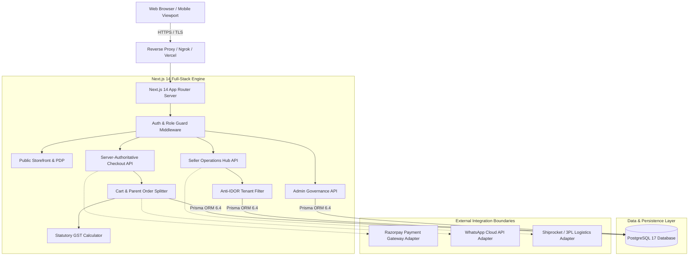
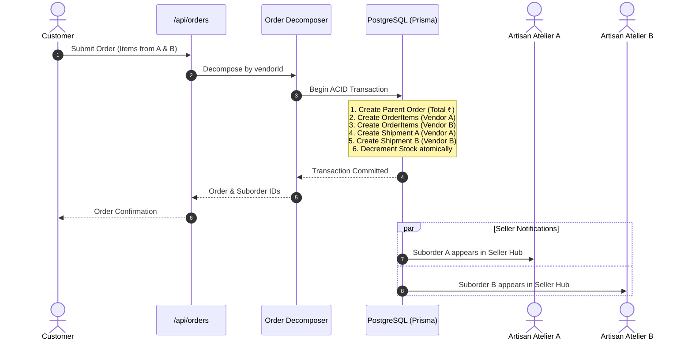

# NEXU ATELIER — Technical Architecture Document

## 1. System Architecture Overview
NEXU ATELIER is architected as a modern, decoupled full-stack e-commerce marketplace utilizing Next.js 14 (App Router), TypeScript, PostgreSQL, and Prisma ORM. It enforces server-authoritative business logic, strict multi-vendor isolation, and statutory Indian financial arithmetic.

---

## 2. Multi-Vendor Order Decomposition Architecture
A hallmark of enterprise marketplace engineering is the seamless decomposition of a single customer checkout containing items from multiple artisan ateliers into autonomous fulfillment units.

---

## 3. Database Schema Architecture (Prisma 6.4 & PostgreSQL 17)
The relational schema comprises 21 models with enforced foreign key cascades, compound indices for tenant queries, and explicit enum state machines:

1. **Identity & Tenancy:**
   - `User`: Global account entity with email, phone, role enum (`CUSTOMER`, `SELLER`, `ADMIN`), passwordHash (PBKDF2), and audit relation.
   - `Seller`: Artisan profile record tied 1:1 to a User, storing business name, GSTIN, PAN, bank details, store slug, commission rate (default 10%), and verification status.
   - `Address`: Customer delivery addresses with pin code, city, state, and address type.

2. **Catalog & Inventory:**
   - `Category`: Hierarchical categories with slugs, image banners, and commission tiers.
   - `Product`: Base product definition storing title, slug, description, basePriceInPaise, hsnCode, gstRate, and vendorId foreign key.
   - `ProductVariant`: Specific SKU variants with size, color, inventoryCount, and priceOverrideInPaise.
   - `ProductImage`: Optimized image assets with priority sorting and alt text.

3. **Commerce & Orders:**
   - `Order`: Parent customer order storing orderNumber, customerId, totalInPaise, taxInPaise, shippingInPaise, paymentStatus (`PENDING`, `PAID`, `FAILED`, `REFUNDED`), paymentMethod (`RAZORPAY`, `COD`, `DEMO`), and delivery address snapshot.
   - `OrderItem`: Line item referencing variant and vendorId, preserving unit price, quantity, tax rate, and fulfillmentStatus (`PENDING`, `PACKED`, `SHIPPED`, `DELIVERED`, `CANCELLED`).
   - `Shipment`: Discrete logistics unit per vendor per order, storing courierName, trackingNumber, AWB, shippingCostInPaise, and currentStatus.

4. **Finance & Governance:**
   - `PaymentRecord`: Tamper-proof transaction log capturing Razorpay orderId, paymentId, signature, and gateway status.
   - `SellerPayout`: Escrow settlement log linking vendorId, grossAmountInPaise, commissionDeductedInPaise, tdsDeductedInPaise, and payoutStatus (`PENDING`, `PROCESSING`, `SETTLED`).
   - `AuditLog`: Immutable system ledger recording actorId, action, entityName, entityId, and JSON diff payload.

---

## 4. Financial & Statutory GST Architecture
The platform enforces exact statutory calculations complying with Indian Ministry of Finance guidelines:

$$\text{Taxable Base (Paise)} = \mathrm{round}\left( \frac{\text{Customer Gross Price}}{1 + \text{GST Rate}} \right)$$

$$\text{Platform Commission (Paise)} = \mathrm{round}\left( \text{Taxable Base} \times 10\% \right)$$

$$\text{Gateway Processing Fee (Paise)} = \mathrm{round}\left( \text{Customer Gross Price} \times 2\% \right)$$

$$\text{Seller Escrow Payout} = \text{Customer Gross Price} - \text{Platform Commission} - \text{Gateway Fee} - \text{Outward Shipping}$$

### Key Compliance Rules:
- **Intra-State Supply (Seller State == Customer State):** Total GST is divided equally into **CGST (50%)** and **SGST (50%)**.
- **Inter-State Supply (Seller State != Customer State):** Total GST is levied wholly as **IGST (100%)**.
- **Zero Floating Point Math:** Every calculation uses integer operations and rounds only at the terminal minor-unit boundary.

---

## 5. Security Architecture & Threat Defense

1. **Authentication:**
   - PBKDF2 with HMAC-SHA512, 210,000 iterations, 32-byte cryptographically secure random salt.
   - Stateless signed JWT session cookies configured with `HttpOnly`, `SameSite=Lax`, and `Secure` attributes.
2. **Anti-IDOR Tenant Enclosure:**
   - Every route in `/api/seller/*` validates the session, retrieves the seller record, and appends `where: { vendorId: seller.id }` to all Prisma queries.
   - Any attempt to access an order item, product, or shipment belonging to another seller returns `403 Forbidden` or `404 Not Found`.
3. **Server-Authoritative Pricing:**
   - The checkout route (`/api/orders`) accepts only variant IDs and quantities from the client. It queries current database prices, stock levels, and tax rates, completely ignoring any price values submitted in the HTTP payload.
4. **Webhook Integrity:**
   - Razorpay webhooks are validated using HMAC-SHA256 signature verification against the raw binary request payload before triggering fulfillment logic.
