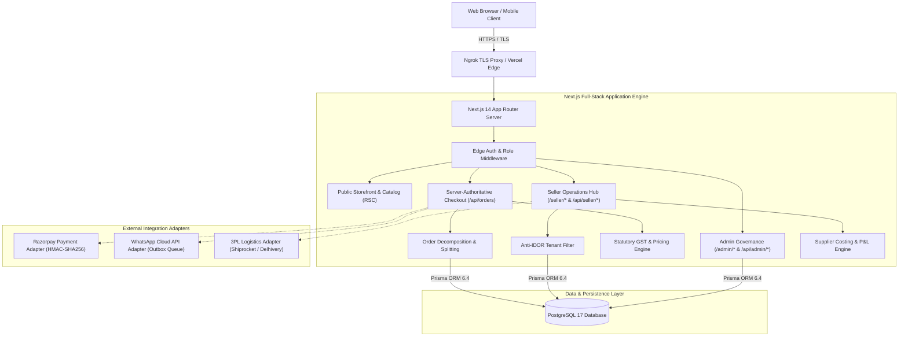
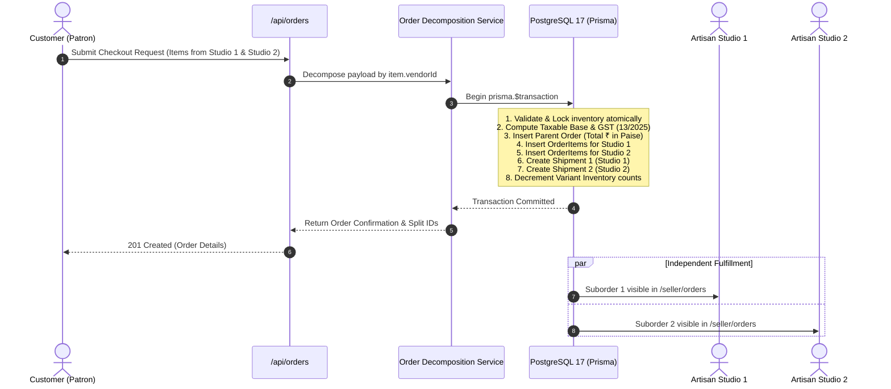

# NEXU ATELIER — Technical Architecture Document

## 1. System Topology & Architectural Overview
NEXU ATELIER is architected as a modular, decoupled full-stack e-commerce marketplace powered by **Next.js 14.2.18 (App Router)**, **TypeScript 5.7.3**, **PostgreSQL 17**, and **Prisma ORM 6.4.1**.



---

## 2. Multi-Vendor Order Splitting Sequence Diagram



---

## 3. Database Architecture (Prisma 6.4 & PostgreSQL 17)
The relational schema comprises **51 models** organized into functional domains:

### 3.1 Identity, Tenancy & Security
- `User`: Global identity storing email, passwordHash (PBKDF2), role (`CUSTOMER`, `SELLER`, `ADMIN`), phone, and timestamps.
- `Seller`: Artisan studio profile tied 1:1 to User; stores storeName, storeSlug, gstin, pan, bankDetails, commissionRate (default 10%), pickupAddress, and verificationStatus (`PENDING`, `APPROVED`, `REJECTED`, `SUSPENDED`).
- `CustomerProfile`: Patron preferences, loyalty status, and saved addresses.
- `Address`: Polymorphic delivery and pickup addresses with pinCode, city, state, and addressType (`HOME`, `STUDIO`, `WORK`).
- `Session`: Signed session store for multi-device token tracking.

### 3.2 Product Catalog & Inventory
- `Category`: Hierarchical taxonomy (Parent/Child) with commission overrides and banner assets.
- `Product`: Base luxury item definition storing title, slug, description, basePriceInPaise, hsnCode, gstRate, and foreign key `vendorId` referencing `Seller`.
- `ProductVariant`: Physical SKU instances with size, color, material, inventoryCount, and priceOverrideInPaise.
- `ProductImage`: High-resolution assets with ordering priority and alt text.

### 3.3 Commerce, Orders & Logistics
- `Order`: Parent order tracking orderNumber, customerId, totalInPaise, taxInPaise, shippingInPaise, paymentStatus (`PENDING`, `ESCROW_HOLD`, `CAPTURED`, `REFUNDED`), and deliveryAddressSnapshot.
- `OrderItem`: Granular line item referencing productVariantId and vendorId; preserves historical unitPriceInPaise, taxRate, and fulfillmentStatus (`NEW`, `PACKED`, `SHIPPED`, `DELIVERED`, `CANCELLED`).
- `Shipment`: Autonomous logistics unit per vendor per order; tracks courierName, trackingNumber, awbCode, shippingCostInPaise, and shipmentStatus.
- `ShipmentTrackingEvent`: Step-by-step milestone logs for carrier tracking.

### 3.4 Governance, Financials & Audit
- `PaymentRecord`: Tamper-proof transaction log storing razorpayOrderId, razorpayPaymentId, raw signature, and status.
- `VendorPayout`: Escrow settlement log linking vendorId, grossSalesInPaise, commissionDeductedInPaise, tdsDeductedInPaise, and payoutStatus (`ESCROW_HOLD`, `ELIGIBLE_FOR_PAYOUT`, `PROCESSING`, `SETTLED`).
- `AuditEvent`: Immutable system audit ledger capturing actorId, action, entityName, entityId, ipAddress, and JSON diff payload.

---

## 4. Multi-Tenant Data Isolation (Anti-IDOR)
To guarantee enterprise-grade isolation across competing artisan studios:
1. **Middleware Role Guard:** Routes matching `/seller/*` and `/api/seller/*` are intercepted by middleware, verifying a valid JWT with role `SELLER`.
2. **Session Tenant Binding:** Route handlers extract the authenticated user ID and resolve the associated `Seller` entity record.
3. **Mandatory Query Scoping:** Every Prisma query executed on behalf of a seller MUST append an explicit `vendorId` filter:
   ```typescript
   // Example: Secure seller order item retrieval
   const orderItem = await prisma.orderItem.findFirst({
     where: {
       id: lineItemId,
       vendorId: authenticatedSeller.id, // Strictly prevents cross-tenant IDOR
     },
     include: { product: true, shipment: true },
   });
   if (!orderItem) {
     return NextResponse.json({ error: 'Order item not found' }, { status: 404 });
   }
   ```
4. **Verification Proof:** Validated by `tests/tenant-security-anti-idor.test.ts` (12/12 tests passing).

---

## 5. Financial & Statutory GST Pipeline
The platform implements exact statutory Indian e-commerce arithmetic in minor units (integer paise):
```
Customer Gross Payment (Paise)
       |
       +---> Taxable Base = round(Gross / (1 + GST_Rate))
       |        |
       |        +---> Total GST = Gross - Taxable Base
       |        |        |
       |        |        +---> Intra-State: CGST (50%) + SGST (50%)
       |        |        +---> Inter-State: IGST (100%)
       |        |
       |        +---> Platform Commission (10%) = round(Taxable Base * 0.10)
       |
       +---> Payment Gateway Fee (2%) = round(Gross * 0.02)
       +---> Outward Shipping Fee (Paise)
       |
       +---> Net Seller Escrow Payout = Gross - Commission - PG_Fee - Shipping
```

---

## 6. Security Architecture & Threat Defense

1. **Cryptographic Standards:**
   - Password Hashing: PBKDF2 with HMAC-SHA512, 210,000 iterations, 32-byte cryptographically secure random salt.
   - Payment Verification: Raw binary HMAC-SHA256 signature validation against `RAZORPAY_KEY_SECRET`.
2. **Session Security:**
   - Stateless JWT tokens signed with `SESSION_SECRET` stored in HTTP-only, `SameSite=Lax`, `Secure` cookies.
3. **Server-Authoritative Integrity:**
   - Checkout endpoint (`/api/orders`) accepts only variant IDs and quantities. Prices, tax rates, and totals are fetched and calculated entirely on the server.
4. **Input Sanitization & Rate Limiting:**
   - Request bodies validated with strict schemas; SQL injection eliminated via Prisma parameterized queries.

---

## 7. Environment Configuration Reference (Names Only)

```text
# Database
DATABASE_URL

# Application & Auth
NODE_ENV
PORT
NEXT_PUBLIC_APP_URL
AUTH_COOKIE_NAME
AUTH_SESSION_TTL_DAYS
SESSION_SECRET

# Payments (Razorpay)
RAZORPAY_KEY_ID
RAZORPAY_KEY_SECRET
RAZORPAY_WEBHOOK_SECRET

# Notifications (WhatsApp & Email)
WHATSAPP_API_TOKEN
WHATSAPP_PHONE_NUMBER_ID
WHATSAPP_BUSINESS_ACCOUNT_ID
RESEND_API_KEY
EMAIL_FROM_ADDRESS

# Logistics (3PL Courier)
SHIPROCKET_EMAIL
SHIPROCKET_PASSWORD

# Object Storage (Images)
AWS_S3_BUCKET
AWS_S3_REGION
AWS_ACCESS_KEY_ID
AWS_SECRET_ACCESS_KEY
```

---

## 8. Staging & Production Deployment Topology
- **Staging Evaluator Access:** Node.js App Server running locally on port 3000, exposed over HTTPS via an active Ngrok TLS reverse proxy tunnel (`https://trailing-ungreased-unhappily.ngrok-free.dev`).
- **Production Topology:** Next.js deployed to Vercel Enterprise or AWS ECS / Docker container cluster; PostgreSQL hosted on AWS RDS or Supabase with connection pooling enabled.
