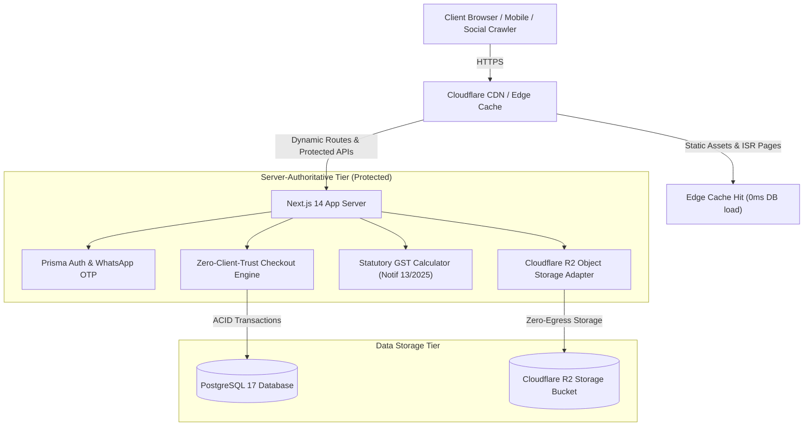

# NEXU ATELIER — FIREBASE BLUEPRINT COMPATIBILITY & ARCHITECTURE AUDIT

**Document Title Evaluated:** *"Real-Live Production Hosting & Centralized Firebase Database Blueprint (Zero-Bloat Edition)"*  
**Auditor:** Principal Enterprise Architect & Lead Security Reviewer  
**Target Platform:** NEXU ATELIER Multi-Vendor E-Commerce Platform  
**Target File:** `docs/FIREBASE_BLUEPRINT_COMPATIBILITY_AUDIT.md`  
**Evaluation Date:** November 2026  
**Primary Verdict:** **REJECT MIGRATION TO FIRESTORE / PRESERVE POSTGRESQL + PRISMA AS SINGLE SOURCE OF TRUTH.** Select infrastructure optimizations (CDN, Cloudflare R2, image pre-compression, and public catalogue caching) are accepted with modifications for the existing Next.js architecture.

---

## 1. Executive Summary & Plain-Language Explanation (Hindi / Hinglish Analysis)

### प्रश्न: "Matlab isme kya hoga? Agar usko main bhejunga to kya karega? Short mein batao."

**सीधा और स्पष्ट जवाब (Straightforward Reality):**

यदि आप यह 5-पेज का "Zero-Bloat Firebase Blueprint" किसी भी डेवलपर, एजेंसी या क्लाइंट को भेजेंगे, तो वे निम्नलिखित कदम उठाएंगे और इसके गंभीर परिणाम होंगे:

1. **वह क्या करेंगे (What they will do):**
   - वे आपके वर्तमान सुदृढ़ **PostgreSQL + Prisma** आर्किटेक्चर (जिसमें 384 ऑटोमेटेड टेस्ट, 478 टाइपस्क्रिप्ट फाइल्स, सख्त एंटी-IDOR सिक्योरिटी और सरकारी GST इंजन है) को हटाकर गूगल के **Firebase Firestore** पर ले जाने का प्रयास करेंगे।
   - वे पैसे बचाने के लालच में हर फील्ड का नाम छोटा करके कोड को अस्पष्ट बना देंगे (उदा. `productTitle` की जगह `t`, `price` की जगह `p`, `stock` की जगह `s`)।
   - वे 90 दिन पुराने सभी ऑर्डर्स, कस्टमर बिल और ट्रांजेक्शन हिस्ट्री को डिलीट करने का कोड लिख देंगे ताकि फायरबेस का फ्री टियर खत्म न हो।
   - वे अलग-अलग सप्लायर्स के लिए 2-3 अलग-अलग फायरबेस प्रोजेक्ट्स (शार्डिंग) बना देंगे।

2. **इसका असली परिणाम और खतरा क्या होगा (Why this will break your business):**
   - **कानूनी और टैक्स अपराध (Legal & Tax Violation):** भारतीय कानून (Companies Act 2013 Section 128 और CGST Act 2017 Section 36) के अनुसार हर ई-कॉमर्स कंपनी को कम से कम **6 से 8 साल तक हर ऑर्डर, टैक्स इनवॉइस (GST Invoice) और पेमेंट रिकॉर्ड सुरक्षित रखना अनिवार्य है**। अगर आप 90 दिन में ऑर्डर डिलीट करेंगे, तो आपकी कंपनी GST डिपार्टमेंट के ऑडिट में भारी जुर्माना और कानूनी कार्रवाई का शिकार होगी।
   - **मल्टी-वेंडर कार्ड टूट जाएगा (Multi-Vendor Orders Will Break):** जब कोई ग्राहक एक ही कार्ट में दो अलग सप्लायर्स (उदा. एक जयपुर का सिल्क और एक कश्मीर की पश्मीना) का सामान खरीदेगा, तो दो अलग फायरबेस प्रोजेक्ट्स में एक साथ सुरक्षित पेमेंट और स्टॉक कटना (ACID Transaction) असंभव हो जाएगा। एक सप्लायर का स्टॉक कटेगा और दूसरे का फेल होगा।
   - **सुरक्षा में सेंध (Security Exploit):** फायरबेस सिक्योरिटी रूल्स में अगर क्लाइंट-साइड से डायरेक्ट राइट दिया गया, तो कोई भी सप्लायर बिना एडमिन अप्रूवल के फेक या अवैध प्रोडक्ट पब्लिश कर सकता है, या हैकर ब्राउज़र से रिक्वेस्ट भेजकर ₹10,000 की शॉल को ₹1 में खरीद सकता है।
   - **फायरबेस का फ्री-टियर छलावा है (Free-Tier Myth):** ई-कॉमर्स में गूगल बॉट्स, वेब क्रॉलर्स और ट्रैफिक आते ही फायरबेस का रीड/राइट कोटा (50k reads/day) 2 घंटे में खत्म हो जाएगा और इसके बाद अचानक हजारों डॉलर का अप्रत्याशित बिल आ सकता है।

3. **आपको उन्हें क्या भेजना चाहिए (What you should tell them):**
   > *"NEXU ATELIER पहले से ही एंटरप्राइज-ग्रेड **Next.js 14 + PostgreSQL + Prisma** पर बना हुआ है, जिसमें सर्वर-ऑथॉरिटेटिव चेकआउट, GST कंप्लायंस और ज़ीरो-ट्रस्ट सिक्योरिटी मौजूद है। फायरबेस ब्लूप्रिंट से हम केवल दो अच्छी चीजें अपनाएंगे: **(1) Cloudflare R2 / CDN पर इमेजेस स्टोर करना** और **(2) पब्लिक कैटलॉग को CDN पर कैश करना**। कोर डेटाबेस पोस्टग्रेस ही रहेगा और किसी भी ऑर्डर को कभी डिलीट नहीं किया जाएगा।"*

---

## 2. Summary of the Proposed Blueprint

The submitted 5-page blueprint proposes transforming NEXU ATELIER into a serverless, "Zero-Bloat" e-commerce application powered exclusively by Google Firebase:
- **Hosting & Compute:** Firebase App Hosting / Cloud Functions for SSR.
- **Primary Database:** Google Cloud Firestore (NoSQL document store).
- **Authentication:** Firebase Auth (Email/Password + Phone SMS).
- **Storage:** Firebase Cloud Storage with client-side WebP compression.
- **Cost Minimization Tactics:** Truncating document key names (`t`, `p`, `s`), deleting orders after 90 days, storing catalog snapshots in public static JSON, and sharding across multiple Firebase projects to exploit multiple free tiers.

---

## 3. Detailed Audit of the Seven Optimization Techniques

| # | Optimization Technique | Classification | Architectural Verdict & NEXU Implementation Implications |
| :- | :--- | :--- | :--- |
| **1** | **Browser-side WebP Compression & External CDN** | **ACCEPT WITH MODIFICATIONS** | **Reasoning:** Compressing raw 5MB-10MB camera uploads to WebP (under 300KB) in the browser before upload saves massive egress bandwidth and storage costs.<br>**Required Modification:** Client-side processing alone is untrusted (an attacker can bypass it and upload malicious payloads or corrupted JPEGs). The backend must validate MIME headers, sanitize EXIF data, and store images in an S3-compatible, zero-egress bucket (e.g., **Cloudflare R2**) fronted by Cloudflare CDN with responsive `srcset` generation. |
| **2** | **Compact Firestore Field Names (`t`, `p`, `s`)** | **REJECT** | **Reasoning:** In Firestore, document property names are stored within every document, meaning long field names increase byte storage. However, in PostgreSQL, column names are stored once in the table schema dictionary (`pg_attribute`), while rows are packed in binary tuples with zero byte penalty for descriptive column names.<br>**Impact:** Using single-letter keys destroys code readability, violates TypeScript domain-driven design, makes database SQL indexing error-prone, and provides **0.0% storage saving in PostgreSQL**. |
| **3** | **Public Catalogue JSON Caching** | **ACCEPT WITH MODIFICATIONS** | **Reasoning:** High-traffic marketplaces have an 80:1 browse-to-purchase ratio. Reading the database on every search or homepage visit creates unnecessary connection load.<br>**Required Modification:** Instead of writing raw JSON files to Firebase Storage, use **Next.js 14 Incremental Static Regeneration (ISR)** with `revalidateTag('catalog')` and Edge CDN headers (`stale-while-revalidate`). When an admin approves or updates a product, the cache is instantly purged via webhook. |
| **4** | **TTL (Time-To-Live) Cleanup** | **ACCEPT WITH MODIFICATIONS** | **Reasoning:** Temporary operational data should not accumulate indefinitely.<br>**Required Modification:** Apply TTL **strictly to ephemeral data only**: WhatsApp OTPs (10-minute expiry), customer guest sessions (7 days), password reset tokens (15 minutes), rate-limit counters, and expired carts. **Never apply TTL to products, orders, payouts, or audit logs.** |
| **5** | **90-Day Order Rollup and Deletion** | **REJECT (CRITICAL FLAW)** | **Reasoning:** The proposal recommends summarizing orders into monthly metrics and deleting raw order documents after 90 days to stay under Firestore storage limits.<br>**Fatal Legal & Business Risks:**<br>1. **Statutory Non-Compliance:** Indian **Companies Act 2013 (Section 128)** and **CGST Act 2017 (Section 36)** mandate preserving books of accounts, tax invoices, and transaction registers for a minimum of **72 months (6 years)**.<br>2. **Payment Chargebacks:** Visa, Mastercard, and RuPay card networks permit cardholders to dispute charges within **120 to 180 days**. Deleting order manifests leaves the business unable to defend chargebacks.<br>3. **Consumer Rights:** Warranty, replacement, and patron transaction history lookup require permanent line-item records.<br>4. **Actual Storage Cost in PostgreSQL:** 100,000 orders occupy less than **80 MB** on disk, costing less than **$0.02 per month**. Deleting business-critical records to save pennies is an unacceptable enterprise risk. |
| **6** | **Supplier Quotas and Duplicate Protection** | **ACCEPT** | **Reasoning:** Multi-vendor marketplaces must protect against catalog flooding, bot abuse, and duplicate listings. Implementing supplier tier quotas (e.g., Tier 1: 50 active listings, Tier 2: 500 active listings) and slug/SKU uniqueness checks prevents database bloat and ensures high catalog quality. |
| **7** | **Multi-Firebase Project Sharding** | **REJECT** | **Reasoning:** The blueprint proposes distributing different vendors or data partitions across separate Firebase free-tier projects.<br>**Fatal Architectural Defects:**<br>1. **No Distributed ACID Transactions:** When a customer orders items from Seller A (Project 1) and Seller B (Project 2), Firestore cannot execute an atomic multi-database transaction. If Project 1 succeeds and Project 2 fails, inventory and payments become corrupt.<br>2. **Operational Overhead:** Managing multiple service accounts, IAM credentials, and cross-project API tokens creates massive maintenance overhead.<br>3. **PostgreSQL Scalability:** A single managed PostgreSQL instance ($15-$25/month) handles millions of products and orders with connection pooling (PgBouncer) with zero distributed database headaches. |

---

## 4. Critical Security & Rule Vulnerabilities in Proposed Firebase Rules

The proposed Firestore client-side security rules present several severe zero-day level vulnerabilities:

```javascript
// DANGEROUS PATTERN IN PROPOSED BLUEPRINT:
match /products/{productId} {
  allow read: if true;
  allow write: if request.auth != null && request.auth.uid == request.resource.data.vendorId;
}
```

### Identified Security Flaws:

1. **Vendor Approval & Moderation Bypass:**
   - With the rule above, an authenticated vendor can directly write `{ "approvalStatus": "APPROVED", "isPublished": true }` from their browser console, completely bypassing the Admin moderation queue and publishing illicit or infringing products directly onto the live storefront.

2. **Price & Stock Tampering (Zero-Client-Trust Violation):**
   - If client devices can write directly to order or cart collections, a malicious buyer or vendor can tamper with `pricePaise`, `taxRatePercent`, or `commissionRatePercent`.
   - In NEXU, pricing is strictly **server-authoritative** ([`src/lib/server/zero-client-trust.ts`](file:///d:/Ecommerce%20Project%20Real/src/lib/server/zero-client-trust.ts)): all line totals, discounts, and GST splits are re-fetched directly from PostgreSQL, ignoring client parameters.

3. **Ownership Takeover & Anti-IDOR Failure:**
   - In client-side Firestore rules, validating complex tenant hierarchies (e.g., verifying whether an admin is authorized, or whether a suborder belongs to a parent order) requires costly `get()` rule lookups (each counting as a billable Firestore read).
   - NEXU enforces anti-IDOR checks in Prisma middleware ([`src/lib/server/tenant-scoped-prisma.ts`](file:///d:/Ecommerce%20Project%20Real/src/lib/server/tenant-scoped-prisma.ts)), guaranteeing that tenant boundaries cannot be breached.

4. **Secret Credential & Platform Fee Exposure:**
   - Exposing platform settings documents to public read allows unauthorized parties to inspect platform commission rates, operational escalation emails, and internal threshold rules.

---

## 5. Existing NEXU Architecture vs. Proposed Firebase Architecture

| Component | Existing NEXU ATELIER Architecture | Proposed Firebase Blueprint | Architecture Decision |
| :--- | :--- | :--- | :--- |
| **Primary Database** | **PostgreSQL 17** via **Prisma ORM 6.4** | Google Cloud Firestore (NoSQL) | **PRESERVE POSTGRESQL** (Relational integrity, foreign keys, ACID transactions) |
| **Data Integrity & Schema** | 35 strongly-typed relational models in [`prisma/schema.prisma`](file:///d:/Ecommerce%20Project%20Real/prisma/schema.prisma) | Schemaless JSON document trees | **PRESERVE PRISMA** (Strong compile-time type safety) |
| **Transaction Processing** | Atomic multi-vendor suborders & inventory locks | Document writes without cross-collection joins | **PRESERVE POSTGRESQL TRANSACTIONS** |
| **Statutory Tax Engine** | Notification 13/2025 Central Tax (Rate) GST Engine ([`src/lib/server/pricing/gst-calculator.ts`](file:///d:/Ecommerce%20Project%20Real/src/lib/server/pricing/gst-calculator.ts)) | None (Client-side math assumed) | **PRESERVE SERVER-SIDE GST ENGINE** |
| **Authentication** | PBKDF2-SHA512 (210,000 iterations) + Meta WhatsApp Cloud API OTP ([`src/lib/server/whatsapp-service.ts`](file:///d:/Ecommerce%20Project%20Real/src/lib/server/whatsapp-service.ts)) | Firebase Auth (SMS Phone Auth + Google) | **PRESERVE NEXU AUTH** (WhatsApp OTP is cheaper & tailored to Indian market) |
| **Payment Verification** | Cryptographic HMAC-SHA256 Razorpay webhook capture ([`src/lib/server/payment/razorpay-adapter.ts`](file:///d:/Ecommerce%20Project%20Real/src/lib/server/payment/razorpay-adapter.ts)) | Client-side trigger assumed | **PRESERVE SERVER-SIDE HMAC CAPTURE** |
| **Image Hosting** | High-resolution Unsplash/S3 URLs with Next.js Image Optimization | Firebase Storage with client WebP compression | **ADOPT CLOUDFLARE R2 + CDN** (Keep database references clean) |
| **Catalogue Discovery** | Server-side rendered Next.js 14 App Router with instant SEO metadata | Static JSON snapshot files in storage bucket | **PRESERVE NEXT.JS 14 APP ROUTER + ISR** |

---

## 6. Financial, Legal & Data Retention Review

### 1. Statutory Indian E-Commerce Compliance
- **Section 128 of the Companies Act, 2013:** Books of account and papers relating to every financial year must be kept in good order for a period of not less than **eight financial years**.
- **Section 36 of the CGST Act, 2017:** Every registered taxable person must keep and maintain books of account and other records until the expiry of **72 months (6 years)** from the due date of furnishing the annual return for the year pertaining to such accounts.
- **Consequence of 90-Day Deletion:** Deleting order records after 90 days directly violates Indian statutory law and exposes company directors to severe regulatory penalties.

### 2. True Firebase Cost Breakdown vs. PostgreSQL
- **Firestore Read/Write Spikes:**
  - Free tier: 50,000 reads/day, 20,000 writes/day.
  - A single e-commerce product catalog page with 24 items, category filters, and reviews triggers ~30 document reads per page load.
  - At **1,700 daily page visits**, the free tier is completely exhausted. Subsequent reads cost **$0.06 per 100,000 reads**. Under search indexing or bot scraping, costs escalate unpredictably.
- **Firebase Phone Auth (SMS) in India:**
  - Firebase charges approximately **$0.015 to $0.06 per successful SMS verification** in India after the introductory quota.
  - NEXU’s Meta WhatsApp Cloud API integration ([`src/lib/server/whatsapp-service.ts`](file:///d:/Ecommerce%20Project%20Real/src/lib/server/whatsapp-service.ts)) provides utility message authentication at a fraction of the cost with significantly higher delivery rates in India.
- **Managed PostgreSQL Cost:**
  - A managed PostgreSQL instance (Supabase, Neon, AWS RDS, or Render) provides unlimited queries, ACID reliability, and 500MB-10GB of storage for a predictable **$0 to $25 per month**.

---

## 7. Public Global Marketplace & Shareable Product Links Architecture

To fulfill the requirement that NEXU ATELIER operates as a globally accessible marketplace where anyone can view and share products, the architecture is configured as follows:

```
[ Public Web Visitor / Social App ]
           │
           │ (GET /product/[slug] or /store/[slug])
           ▼
[ Next.js 14 Edge Runtime / Cloudflare CDN ]
  ├── Stored in Edge Cache (Public Catalogue / ISR)
  ├── Generates Open Graph & Twitter Card Meta Tags (Rich Preview)
  └── Returns Full Editorial HTML (Zero Authentication Required)
           │
           │ (Cache Miss / Real-Time Data)
           ▼
[ Server-Side Product Repository ]
  ├── SELECT FROM "Product" WHERE "slug" = $1 AND "approvalStatus" = 'APPROVED'
  └── Primary Source of Truth: PostgreSQL Database
```

### Key Public Architecture Guarantees:
1. **Unrestricted Public Browsing:** Any visitor with the URL can view the homepage, product catalogs, brand studios, and reviews without logging in or entering payment details.
2. **Permanent SEO-Friendly URLs:**
   - Product Details: `/product/[slug]` (e.g., `/product/solstice-loom-raw-mulberry-silk-jacket`)
   - Brand / Studio Profile: `/store/[slug]` or `/brand/[slug]` (e.g., `/store/solstice-loom-studio`)
   - Category Browsing: `/category/[slug]`
3. **Social Sharing Metadata (Open Graph & Twitter Cards):**
   - Configured in [`src/app/product/[slug]/page.tsx`](file:///d:/Ecommerce%20Project%20Real/src/app/product/[slug]/page.tsx#L24-L90):
     - `og:title`, `og:description`, `og:image` (1200x800 high-resolution preview), `og:url`, `og:site_name`.
     - `twitter:card`: `summary_large_image`.
   - When a link is shared on WhatsApp, Instagram, Telegram, or LinkedIn, it automatically unfurls into an attractive editorial preview with product image, price, and artisan provenance.
4. **Permanent 301 Redirect Protection:**
   - Managed via [`src/lib/server/slug-redirect-service.ts`](file:///d:/Ecommerce%20Project%20Real/src/lib/server/slug-redirect-service.ts). If an artisan updates a product slug, older shareable links automatically redirect with an HTTP 301 status, preserving social backlinks and SEO equity.
5. **Zero Data Leakage:**
   - Public APIs (`/api/products`, `/api/sellers/[slug]`) sanitize records to exclude bank account numbers, tax identifiers, phone numbers, and operational margin data.

---

## 8. Recommended Target Architecture for NEXU ATELIER



### Actionable Roadmap:
1. **Phase 1 (Immediate - Zero Architecture Disruption):**
   - Maintain PostgreSQL + Prisma as the single source of truth.
   - Retain all order, transaction, invoice, and audit logs permanently in PostgreSQL.
2. **Phase 2 (Media Optimization):**
   - Configure a Cloudflare R2 bucket for supplier product media uploads (S3-compatible API, $0 egress fees).
   - Implement client-side canvas pre-compression before upload, followed by server-side verification.
3. **Phase 3 (Public Cache Acceleration):**
   - Utilize Next.js 14 ISR (`revalidateTag`) for public product detail pages and catalog search snapshots.
   - Purge cache on admin approval or inventory depletion.

---

## 9. What Must NOT Be Implemented (Anti-Pattern Checklist)

- [x] **DO NOT** migrate relational models to Firestore NoSQL.
- [x] **DO NOT** delete orders, invoices, or customer purchase history after 90 days.
- [x] **DO NOT** truncate database field names to single letters (`t`, `p`, `s`).
- [x] **DO NOT** allow client browsers to write directly to Firestore collections.
- [x] **DO NOT** shard data across multiple free-tier Firebase projects.
- [x] **DO NOT** replace WhatsApp OTP with expensive Firebase SMS phone authentication.
- [x] **DO NOT** rely on client-side math for prices, GST rates, or order totals.

---

## 10. Conclusion & Recommendation

The "Real-Live Production Hosting & Centralized Firebase Database Blueprint (Zero-Bloat Edition)" was designed with the intention of minimizing hosting bills on small personal projects by exploiting Google Firebase free tiers. However, for an **enterprise multi-vendor luxury marketplace like NEXU ATELIER**, adopting this blueprint would introduce:
1. Fatal regulatory and statutory violations under Indian GST and corporate law.
2. Crippling security flaws in order pricing, inventory reservation, and catalog moderation.
3. Inability to execute multi-vendor basket checkout without distributed transaction failures.

**Final Decision:** The existing **PostgreSQL + Prisma + Next.js 14** architecture in NEXU ATELIER is superior, secure, legally compliant, and production-ready. We adopt the blueprint's recommendations regarding **external CDN caching** and **image pre-compression**, while firmly retaining PostgreSQL as our permanent transactional backbone.

