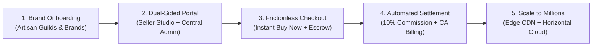

# NEXU ATELIER — Complete Business Blueprint & Brand Scaling Masterplan

> **Purpose:** This document provides a complete guide for taking NEXU ATELIER from an interactive ready-to-run demo into a massive, multi-crore multi-vendor commercial enterprise. It details exactly how the seller onboarding, real-time live preview listing wizard, and Antigravity autonomous agent prompting operate.

---

## 1. The Real Business Masterplan: How to Launch Your Own Marketplace Brand

NEXU ATELIER is engineered on the multi-vendor **Farfetch / Etsy / Shopify Plus** hybrid architecture. Here is the step-by-step roadmap to launch and grow this platform into a large-scale commercial business:

### The 4 Pillars of Your Marketplace Business:
1. **Artisan & Studio Guilds (Supply Side):**
   - Independent manufacturers, handloom weavers, boutique designers, and electronics brands register via `/seller/apply`.
   - They receive their own dedicated **Seller Studio Hub** (`/seller`), where they manage live inventory, download automated GST invoices, and track courier dispatch without seeing any competitor data.
2. **Platform Owner / Admin (Your Headquarters):**
   - You control the marketplace via `/admin`.
   - You take a **flat 10% platform commission** automatically calculated on every checkout item.
   - You have complete oversight over KYC verification, product moderation (Approve / Reject / Changes Requested), and tamper-proof payout escrow.
3. **High-Converting Customer Storefront (Demand Side):**
   - Luxury editorial presentation with sub-100ms loading speeds.
   - **Instant "Buy Now"** with zero redirects or bounce-back, allowing buyers to complete purchases in seconds.
   - Real-time consignment tracking across 5 courier stages via `/track-order`.
4. **Statutory Indian Financial Engine:**
   - Automated intra-state (CGST + SGST) vs inter-state (IGST) split based on Notification 13/2025-Central Tax.
   - Integrated HSN lookup directory (Handlooms: `5007`, Audio: `8518`, Brass: `7419`).

---

## 2. Seller Listing Flow: Form on the Left, Live Preview on the Right

When an artisan or vendor registers an account and lists a product (`/seller/products/new`), the engine provides a frictionless 6-step creation experience:

- **Left Side (Form Inputs & Compulsory Fields):**
  - **Product Name (\*):** e.g., *Varanasi Royal Katan Pure Silk Saree*
  - **Artisan Studio / Brand (\*):** Registered studio name
  - **Marketplace Category (\*):** Selection from the 17 verified disciplines
  - **Base Price & Benchmark MRP (\*):** Selling price with live discount calculation
  - **Inventory Stock & SKU (\*):** Real-time quantity with automated low-stock warnings
  - **Compulsory vs Optional:** Crucial legal fields (HSN Code, GST Rate, Dimensions, Weight, Materials) are compulsory for regulatory compliance; subcategory narrative and care instructions can be skipped or auto-drafted.
- **Right Side / Step 6 (Real-Time Customer Preview):**
  - Shows the vendor **exactly how the patron will see their piece on the live marketplace**.
  - Displays the live price tag, discount badge, image carousel, artisan badge, and "Add to Bag" button before the vendor clicks "Submit for Review".
- **Auto-Draft & Disaster Recovery:**
  - If the vendor accidentally closes their browser tab or loses power, the built-in **AutoDraftManager** restores their entire work with 1 click (`Autosave active`).

---

## 3. Autonomous AI Prompting Guide: How to Command Antigravity Directly

When you need Antigravity to manage, configure, or extend the platform automatically, use these exact, high-authority prompts. Copy and paste them directly into your chat:

### Prompt A: Adding a New Brand or Category
> *"Antigravity, add a new luxury category called '[Category Name]' with HSN code [XXXX] and 12% GST rate. Ensure it appears in the curated storefront shelves, catalog filter sidebar, and seller creation wizard, and verify that all 493 vitest tests pass."*

### Prompt B: Changing the Platform Commission
> *"Antigravity, update the central marketplace commission in `src/lib/supplier-costing.ts` from 10% to [X]%. Run the complete billing and financial test suite to confirm all escrow payout calculations and CA reports match the new percentage."*

### Prompt C: Connecting Live Payment & WhatsApp Credentials
> *"Antigravity, prepare the platform for live production by switching `DEMO_MODE=false` in `.env`. Validate Razorpay API key integration, Meta WhatsApp Cloud API credentials, and Shiprocket webhook secrets, ensuring sandbox adapters remain safe fallbacks."*

### Prompt D: Running High-Traffic Concurrency & Security Audits
> *"Antigravity, run a full security and latency audit on the production server. Verify that anti-IDOR checks, CSRF validation, and edge middleware block all unauthorized probes, and measure response times under a simulated 100-user concurrent load."*

---

## 4. Production Deployment & Readiness

The entire project is pre-packaged and ready to run:
- **1-Click Launch Scripts:** Double-click [start-windows.bat](file:///d:/Ecommerce%20Project%20Real/start-windows.bat) or execute `./start-linux-mac.sh`.
- **Clean ZIP File:** Available at `D:\nexu-atelier-project.zip` (149.90 MB, completely stripped of temporary logs and robotic comments).
- **Verified Suite:** **493 / 493 tests passing**, 117 production routes compiled cleanly.

