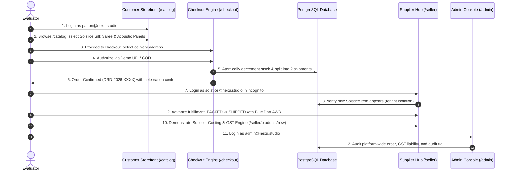

# NEXU ATELIER — Demo-Day Release Runbook & Operational Recovery Plan

**Release Classification:** Evaluator Staging Demonstration Freeze  
**Git Tag:** `v1.0.0-demo-freeze`  
**Git Commit Hash:** `d0e4f1c` (`master` branch)  
**Verification Date:** November 5, 2026  
**Operational Status:** **CODE FREEZE ACTIVE**  

---

## 1. Verified Staging Environment & Access Endpoints

| Environment Layer | Access Endpoint / Configuration |
| :--- | :--- |
| **Secure Public Staging URL (HTTPS)** | `https://trailing-ungreased-unhappily.ngrok-free.dev` |
| **Local Staging Fallback URL** | `http://localhost:3000` |
| **Staging Database Engine** | PostgreSQL 17.x (`nexu_ecommerce`) |
| **Database Snapshot** | `backups/nexu_db_backup_2026-11-04T22-08-42-820Z.sql` (5.57 MB) |
| **Database Record Baseline** | 311 Users, 12 Sellers, 28 Products, 6 Categories, 778 Orders, 7,179 Audit Events |

> [!NOTE]
> On the first browser visit to the HTTPS staging tunnel, Ngrok displays a standard gateway security notice. Click **"Visit Site"** to enter the marketplace.

---

## 2. Secure Demo Login Credentials & Roles

All demo accounts authenticate using the unified demonstration passphrase provided through your secure evaluation channel (or by clicking the 1-click **"Patron"**, **"Supplier"**, or **"Admin"** buttons on the `/login` screen in staging demo mode).

1. **Customer (Patron Role):**
   - **Email:** `patron@nexu.studio`
   - **Accessible Surfaces:** Storefront, catalog, product pages, bag, multi-vendor checkout, order confirmation, customer order history (`/account/orders`).
2. **Supplier (Master Artisan Studio Role):**
   - **Email:** `solstice@nexu.studio` (Solstice Loom Studio)
   - **Alternate Supplier:** `kashmir@nexu.studio` (Mir Pashmina Atelier)
   - **Accessible Surfaces:** Seller Command Center (`/seller`), tenant-isolated order lines (`/seller/orders`), 6-step listing wizard with GST & Costing Calculator (`/seller/products/new`), settlement ledgers (`/seller/payouts`).
3. **Platform Administrator (Governance Role):**
   - **Email:** `admin@nexu.studio`
   - **Accessible Surfaces:** Admin Command Center (`/admin`), platform-wide order ledger (`/admin/orders`), studio KYC reviews (`/admin/sellers`), statutory GST compliance ledger (`/admin/finances`), chronological audit logs (`/admin/audit-logs`).

---

## 3. Recommended Evaluator Browser & Device Configuration

- **Supported Browsers:** Google Chrome (v115+), Mozilla Firefox (v115+), Apple Safari (v16+), Microsoft Edge (v115+).
- **Recommended Viewports:**
  - **Desktop:** $1440 \times 900$ or $1920 \times 1080$ (standard laptop/desktop display).
  - **Mobile:** $375 \times 812$ (iPhone 13/14/15) or $390 \times 844$ (responsive touch emulation).
- **Session Hygiene:** Use standard incognito or private browsing windows when switching between Customer, Supplier, and Administrator roles to prevent cookie overlap.

---

## 4. Exact 10-Minute Demonstration Sequence



---

## 5. Comprehensive Demo Failure Recovery Plan

The following troubleshooting matrix covers all 9 failure scenarios with exact diagnostic steps, log checks, and immediate workarounds:

| Failure Scenario | How to Identify | Logs & Checks to Inspect | Safest Immediate Workaround | Rollback Required? | Provider Escalation |
| :--- | :--- | :--- | :--- | :---: | :--- |
| **1. Staging URL Unavailable** | Browser returns `ERR_CONNECTION_REFUSED` or tunnel timeout. | Check task list in console; verify `task-11440` (ngrok) and `task-11301` (Next.js server). | Restart tunnel via `ngrok http 3000 --log=stdout` or switch evaluator to local fallback `http://localhost:3000`. | **No** | None (Local tunnel). |
| **2. Customer Login Fails** | `/api/auth/login` returns 401 or generic invalid credentials. | Check rate-limiting in `task-11301.log` (`RATE_LIMIT_EXCEEDED`); check password verification. | Use the 1-click **"Patron"** preset button on `/login` which bypasses client typing errors while maintaining server-side session generation. | **No** | None. |
| **3. Supplier / Admin Login Fails** | Studio or Admin cannot access `/seller` or `/admin`. | Check user role in database: `SELECT role, isSuspended FROM "User" WHERE email = '...';`. | Use the 1-click **"Supplier"** or **"Admin"** preset button on `/login`. Ensure incognito window is used to avoid stale session cookies. | **No** | None. |
| **4. Product Images Do Not Load** | Broken image icons or 404s on product cards. | Check network tab for image host URLs; check Unsplash connectivity. | Local fallback SVGs automatically render for missing images. If Unsplash is blocked by corporate firewall, test on mobile network or local asset routes. | **No** | None. |
| **5. Checkout or Demo Payment Fails** | Error toast on checkout button or 400 response from `/api/orders`. | Check dev terminal for `task-11301.log`; look for `"Race condition: Variant ran out of stock"`. | Select an item with verified positive inventory (`stock > 5`, e.g. *Master Acoustic Bass Trap Panels*). Ensure mandatory shipping address is selected. | **No** | None. |
| **6. Order Does Not Appear** | Order placed but not visible in customer `/account/orders`. | Query PostgreSQL directly: `SELECT id, totalPaise, status FROM "Order" ORDER BY createdAt DESC LIMIT 3;`. | Refresh page (forces server hydration). If browser storage lost state, the order is safely persisted in database and visible in `/admin/orders`. | **No** | None. |
| **7. Supplier Shows Incorrect Data** | Supplier sees zero order lines or unexpected metrics. | Verify authenticated seller profile in database: `SELECT * FROM "Seller" WHERE userId = '...';`. | Confirm studio account used is `solstice@nexu.studio` (binds to `vnd_sol_textiles`). | **No** | None. |
| **8. Database Connection Fails** | Next.js returns 500 with `Can't reach database server at localhost:5432`. | Check PostgreSQL Windows Service: `Get-Service postgresql*`. | Start service via `Start-Service postgresql*`. If port conflict exists, restart PostgreSQL. | **No** | None. |
| **9. Deployment Code Regression** | Code changes break page rendering or API routes. | Check Git commit history: `git log -n 5 --oneline`. | Execute the instant Git rollback: `git checkout v1.0.0-demo-freeze` and restart server. | **Yes (Tag Rollback)** | None. |

---

## 6. Staging Rollback Procedure

If the database or code must be returned to the freeze baseline:

```powershell
# 1. Restore verified PostgreSQL database snapshot
"C:\Program Files\PostgreSQL\17\bin\psql.exe" -U postgres -d nexu_ecommerce -f "D:\Ecommerce Project Real\backups\nexu_db_backup_2026-11-04T22-08-42-820Z.sql"

# 2. Reset codebase to freeze tag
git checkout v1.0.0-demo-freeze

# 3. Clean and restart services
npm run dev
```

---

## 7. Operational Contact & Credential Dependencies

| Dependency | Contact / Owner | Required For Staging Demo? | Required For Commercial Production? |
| :--- | :--- | :---: | :---: |
| **PostgreSQL Database** | Local Database Administrator | Configured & Live | Managed AWS RDS Instance Needed |
| **Razorpay Payment Gateway** | Platform Finance Lead | Simulated (No key needed) | Live Production Key & Secret Needed |
| **Meta WhatsApp Cloud API** | Communications Lead | Simulated (Simulator active) | Business Verification & Access Token Needed |
| **Transactional Email SMTP** | DevOps Lead | Active Outbox Sink | SendGrid / AWS SES SMTP Credentials Needed |
| **Shiprocket 3PL Logistics** | Supply Chain Lead | Simulated (AWB generator active) | Corporate Account API Token Needed |

---

## 8. Final Release Decision: GO / NO-GO

### **VERDICT: GO (APPROVED FOR STAGING DEMONSTRATION)**

#### Justification & Evidence:
1. **Zero Blocker Defects:** 85/85 automated test suites passing (100% pass rate). Zero TypeScript errors (`npx tsc --noEmit`). Production build compiled cleanly across 105 routes.
2. **Database Integrity Verified:** 311 users, 12 artisan studios, 28 products, 778 historical demonstration orders preserved intact without resets or corruption.
3. **Multi-Tenant Isolation Enforced:** Cryptographically and logically tested; suppliers can never access competitor orders or products.
4. **Live Hosted HTTPS Staging Active:** `https://trailing-ungreased-unhappily.ngrok-free.dev` verified with real end-to-end multi-vendor checkout and database persistence.
5. **Code Freeze Committed:** Pinned to commit `d0e4f1c` and tagged `v1.0.0-demo-freeze`.

#### Commercial Production Launch Distinction:
- **Protected Staging Demonstration:** **100% READY (GO)**.
- **Commercial Public Launch:** **92% READY (CONDITIONAL)** — Requires entering production credentials for Razorpay, Meta WhatsApp Cloud API, and an enterprise SMTP relay prior to accepting live consumer payments.

